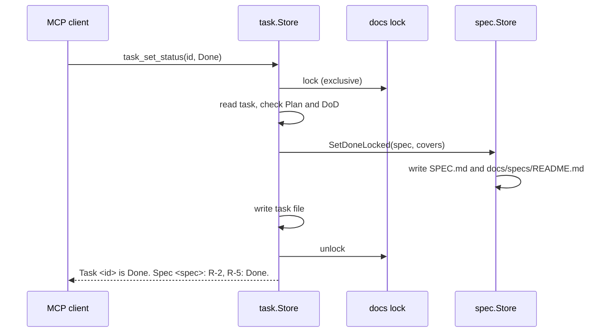

# Local tasks and task tools

## 1. Summary

A task is a local work item. It belongs to one spec. It is stored in the project data directory, not in git. The task tools create, change, check, move and delete tasks. They enforce the status rules. When a task is Done, its covered requirements become Done in the spec.

## 2. Problem

Task files in git make the repository large. Two branches can create tasks with the same number, so the IDs collide. The current behavior of a feature is spread over many closed tasks. The tools must enforce the status rules, so that an agent cannot skip a step. See ADR-008.

## 3. Goals

- G-1: Tasks are local. All worktrees of one repository share them. No counter gives the ID.
- G-2: Many processes can change tasks and specs at the same time, with no lost write and no corrupt file.
- G-3: A Done task sets its covered requirements to Done in the spec.

## 4. Out of Scope

- The spec tools. See `docs-spec`.
- The resume command and the SessionStart hook. See `resume-command`.
- The shared rules for document files, such as title length, the README index, frontmatter format, atomic writes and renames. See `docs-common`.
- The docs lock rules. See `docs-common`. The move of the project data directory. See `project-data`.

## 5. Requirements

| ID | Requirement | Status |
| :--- | :--- | :--- |
| R-1 | Each task is a file tasks/<spec>/<task-slug>.md in the project data directory, or in tasks/general/ with no spec, with the ID <spec>/<task-slug>, and all worktrees of a repository see the same tasks. | Done |
| R-2 | A task has the frontmatter id, title, status, priority, covers and depends_on, and the sections Brief, Plan, Notes and Definition of Done. | Done |
| R-3 | task_create refuses a task with no Brief, with no Plan step, or with a slug that is not kebab-case or is longer than 40 characters. | Done |
| R-4 | task_update_section changes only the Brief, Plan and Notes sections, and refuses the Definition of Done section. | Done |
| R-5 | A task has the status Todo, In Progress, Blocked or Done, with the allowed changes only, and a Done task is final: all task tools refuse its change except task_move and task_delete. | Done |
| R-6 | depends_on refuses a task of another spec, a missing task, the task itself, and a dependency that makes a cycle. | Done |
| R-7 | covers refuses a requirement that the spec does not have, accepts a requirement that is Done, and is refused for a general task. | Done |
| R-8 | A task goes to In Progress only when its spec is Approved and all depends_on tasks are Done; a general task has no spec check. | Done |
| R-9 | A task goes to Blocked only with a note, and a note for another status is optional; a given note is added to Notes as "<status>: <note>". | Done |
| R-10 | A task goes to Done only when all Plan steps and all Definition of Done items are checked, and then the covers requirements are set to Done in the spec with a Document History row. | Done |
| R-11 | When a task goes to Done, the spec is written before the task, so a retry after a failure changes nothing twice. | Done |
| R-12 | task_step_check checks one Plan step by its number, and refuses a step that is already checked or does not exist. | Done |
| R-13 | The Definition of Done tools check, uncheck, add and remove an item; a removal needs a reason and writes the item text and the reason to Notes. | Done |
| R-14 | task_move moves one or more tasks of one spec to another spec or to or from general, changes id and depends_on, removes covers, and writes the old covers to Notes. | Done |
| R-15 | task_move and task_delete check all tasks of the call before any change, and refuse a dependency that would cross specs or break a task that stays. | Done |
| R-16 | A retry of task_move accepts a task already moved and removes the old file, and task_move and task_delete remove an empty tasks/<spec>/ folder. | Done |
| R-17 | task_delete deletes the given tasks and refuses a missing ID and a task outside the call that depends on a task of the call. | Done |
| R-18 | spec_delete refuses while the tasks folder of the spec has a task file, and gives the number of tasks and the tools to move or delete them. | Done |
| R-19 | Each task write holds the docs lock of the project data directory, so a task change and its spec change run under one lock, and a Done change also writes the spec index. | Done |
| R-20 | task_list gives one line for each task with its ID, status, priority and title, in the order of spec (general last), status, priority and ID, and task_get gives the full task or one section. | Done |
| R-21 | The task tools that the plugin texts name (dx:task skill, dx:grill skill) are registered tools of the dx server. | Done |

## 6. Design

### 6.1 Modules

- `internal/docs/task`: the task store and the task tools. Each write calls the spec store in the same docs lock.
- `internal/docs/spec`: the spec methods `RequirementsLocked` and `SetDoneLocked`, and the `spec_delete` check of the task folder. This package does not import `internal/docs/task`.
- `internal/project`: the constants `DocsLock` and `Tasks`, and the project data directory.
- `internal/mcpserver`: registers the task tools. It sets the task folder and the spec store of the task store.
- `internal/plugin/assets/skills/task/SKILL.md`: the dx:task skill text.

### 6.2 File layout

A task is `<data dir>/tasks/<spec>/<task-slug>.md`. A task with no spec is in `<data dir>/tasks/general/`. The data directory is `<git-common-dir>/dx/` in a git repository, else `<cache>/projects/<key>/`. See ADR-007 and ADR-008.

### 6.3 Frontmatter and sections

The frontmatter has `id`, `title`, `status`, `priority`, `covers` and `depends_on`. The ID is `<spec>/<task-slug>`. The sections are Brief, Plan, Notes and Definition of Done, in this order. The Brief has what to do, the files, the constraints and the check commands. The Plan is a list of steps. Each step has one action and its check. See ADR-008.

```markdown
---
id: docs-lock/shared-reads
title: Shared lock for reads
status: Todo
priority: P1
covers: [R-2, R-3]
depends_on: [docs-lock/lock-path]
---
```

### 6.4 Status flow

- `Todo` can change to `In Progress` or `Blocked`.
- `In Progress` can change to `Todo`, `Blocked` or `Done`.
- `Blocked` can change to `Todo` or `In Progress`.
- `Done` is final. Only `task_move` and `task_delete` change a Done task.

### 6.5 Protected sections

- `task_update_section` changes only the Brief, Plan and Notes.
- Only the Definition of Done tools change the Definition of Done.
- `task_step_check` checks one Plan step.
- The tools add the lines to Notes. Each line that a tool adds is a list item.

### 6.6 Writes and locks

Each task write holds the exclusive docs lock of the project data directory. Each read holds the shared lock. A task change and its spec change use one lock. The Done change writes the spec first, so a retry after a failure is safe. The lock rules are in `docs-common`.



### 6.7 Tool list

`task_list`, `task_get`, `task_create`, `task_update_section`, `task_update_fields`, `task_set_status`, `task_step_check`, `task_dod_check`, `task_dod_uncheck`, `task_dod_add`, `task_dod_remove`, `task_move` and `task_delete`. The tools use compact text results. See ADR-002.

## 7. Acceptance Criteria

- R-1: `TestWorktreesShareTasks` (`internal/mcpserver/server_test.go`); `TestDataDir` (`internal/project/data_test.go`).
- R-2, R-3, R-7: `TestCreate` (`internal/docs/task/task_test.go`).
- R-4: `TestUpdate` (`internal/docs/task/task_test.go`).
- R-5: `TestStatus` (`internal/docs/task/task_test.go`).
- R-6: `TestCreate` and `TestUpdate` (`internal/docs/task/task_test.go`).
- R-8, R-9, R-10, R-11, R-12: `TestStatus` (`internal/docs/task/task_test.go`); `internal/docs/spec` tests for `SetDoneLocked` and `RequirementsLocked`.
- R-13: `TestDoD` (`internal/docs/task/task_test.go`).
- R-14, R-15, R-16, R-17: `TestMoveAndDelete` and `TestMoveRetry` (`internal/docs/task/task_test.go`).
- R-18: `TestDelete` (`internal/docs/spec/delete_test.go`).
- R-19: `TestHoldDocsLock` and `TestTwoProcesses` (`internal/docs/task/lock_test.go`).
- R-20: `TestListAndGet` (`internal/docs/task/task_test.go`).
- R-21: `TestPluginTextsNameRegisteredTools` and `TestToolNames` (`internal/mcpserver/server_test.go`).
- The tests pass on macOS, Linux and Windows.

## 8. Open Questions

| ID | Question | Owner | Answer |
| :--- | :--- | :--- | :--- |
| — | None. | — | — |

The status cannot be `Approved` while a question is `Open`.

## 9. Document History

| Date | Author | Description / Change Notes |
| :--- | :--- | :--- |
| 2026-10-27 | Equal | Initial draft specification |
| 2026-10-27 | Equal | Added R-1. |
| 2026-10-27 | Equal | Added R-2. |
| 2026-10-27 | Equal | Added R-3. |
| 2026-10-27 | Equal | Added R-4. |
| 2026-10-27 | Equal | Added R-5. |
| 2026-10-27 | Equal | Added R-6. |
| 2026-10-27 | Equal | Added R-7. |
| 2026-10-27 | Equal | Added R-8. |
| 2026-10-27 | Equal | Added R-9. |
| 2026-10-27 | Equal | Added R-10. |
| 2026-10-27 | Equal | Added R-11. |
| 2026-10-27 | Equal | Added R-12. |
| 2026-10-27 | Equal | Added R-13. |
| 2026-10-27 | Equal | Added R-14. |
| 2026-10-27 | Equal | Added R-15. |
| 2026-10-27 | Equal | Added R-16. |
| 2026-10-27 | Equal | Added R-17. |
| 2026-10-27 | Equal | Added R-18. |
| 2026-10-27 | Equal | Added R-19. |
| 2026-10-27 | Equal | Added R-20. |
| 2026-10-27 | Equal | Added R-21. |
| 2026-10-27 | Equal | R-1: status Done. |
| 2026-10-27 | Equal | R-2: status Done. |
| 2026-10-27 | Equal | R-3: status Done. |
| 2026-10-27 | Equal | R-4: status Done. |
| 2026-10-27 | Equal | R-5: status Done. |
| 2026-10-27 | Equal | R-6: status Done. |
| 2026-10-27 | Equal | R-7: status Done. |
| 2026-10-27 | Equal | R-8: status Done. |
| 2026-10-27 | Equal | R-9: status Done. |
| 2026-10-27 | Equal | R-10: status Done. |
| 2026-10-27 | Equal | R-11: status Done. |
| 2026-10-27 | Equal | R-12: status Done. |
| 2026-10-27 | Equal | R-13: status Done. |
| 2026-10-27 | Equal | R-14: status Done. |
| 2026-10-27 | Equal | R-15: status Done. |
| 2026-10-27 | Equal | R-16: status Done. |
| 2026-10-27 | Equal | R-17: status Done. |
| 2026-10-27 | Equal | R-18: status Done. |
| 2026-10-27 | Equal | R-19: status Done. |
| 2026-10-27 | Equal | R-20: status Done. |
| 2026-10-27 | Equal | R-21: status Done. |
| 2026-10-27 | Equal | Approved by the user. |
| 2026-10-27 | Equal | Changed fields: related. |
| 2026-10-27 | Equal | R-21: text changed. |
| 2026-10-27 | Equal | Status: In Review. The scope changed in section 4. |
| 2026-10-27 | Equal | Approved by the user after the reference change (ADR-012). |