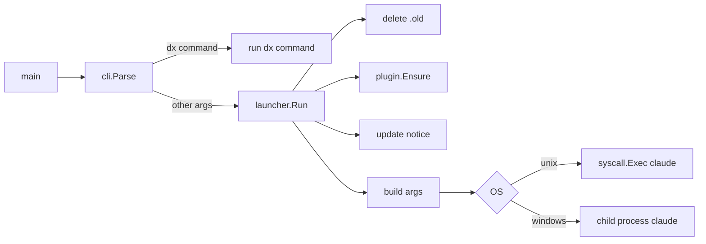

# TASK-002: Launcher and plugin loading

## Document History
| Date | Author | Description / Change Notes |
| :--- | :--- | :--- |
| 2026-10-25 | Claude | Initial draft specification from the design interview |
| 2026-10-25 | Equal | Open questions answered. Approved. |
| 2026-10-25 | Equal | Work started. |
| 2026-10-25 | Claude | FR-6 adds only flags with content; FR-8 moved to TASK-003; `.mcp.json` moved to TASK-004; FR-4 escapes the binary path for JSON. |
| 2026-10-25 | Equal | Done. All acceptance criteria pass. |

## 1. Summary
`claude-dx` parses its own commands, extracts the embedded `dx` plugin to the cache and starts `claude` with `--plugin-dir`, `--settings` and `--append-system-prompt`. It passes all other arguments to `claude`.

## 2. Problem and Motivation
The developer must get dx in Claude Code with one command and no change to project or user configuration (ADR-001).

## 3. Goals
- G-1: `claude-dx <args>` starts `claude <dx flags> <args>` with the same TTY, signals and exit code.
- G-2: `claude-dx --help` shows dx help and does not start `claude`.
- G-3: In the session, `/dx:` skills from the embedded plugin are available.

## 4. Out of Scope
- `update`, `cache clean`, `doctor`: TASK-003.
- MCP tools: TASK-004 and later.
- `report` and `hook`: TASK-012.

## 5. Context
### 5.1 Current State
TASK-001 gives `cmd/claude-dx/main.go` with `--version`.

### 5.2 Assumptions
- A-1: A plugin loaded with `--plugin-dir` gives its skills the prefix `<plugin name>:`. Verified on 2.1.308: a test plugin named `dx` with skill `hello` shows `dx:hello` in `skills` and `slash_commands` of the `stream-json` init event; the plugin source is `dx@inline`.
- A-2: The permission rule name of a plugin MCP tool. Verified on 2.1.308: server `dx` in the plugin `.mcp.json` shows as `plugin:dx:dx`, and its tool `ping` is `mcp__plugin_dx_dx__ping`. In `--settings`, the rule `mcp__plugin_dx_dx__ping` allows one tool and `mcp__plugin_dx_dx` allows all tools of the server. With no rule, `claude -p` denies the tool.
- A-3: `--settings` accepts a JSON string. Verified: `claude --help` of 2.1.308.
- A-4: `hooks/hooks.json` of a plugin loaded with `--plugin-dir` runs. Verified on 2.1.308: a `PreToolUse` hook with matcher `Bash` ran before each Bash call.

### 5.3 Constraints
- ADR-001, ADR-003. Go standard library only for the parser.

## 6. Requirements
### 6.1 Functional
- FR-1: The parser obeys ADR-003. dx commands: `--help`, `-h`, `--version`, `update`, `cache clean`, `doctor`, `report`, `mcp`, `hook`. Only the first argument selects a dx command. `--` as the first argument passes all later arguments to `claude`.
- FR-2: At start, the launcher deletes `<binary>.old` if it exists, and ignores errors.
- FR-3: The launcher extracts `internal/plugin/assets` to `<cache>/plugin/<version>/` if the directory does not exist. It writes into a temporary directory and renames it, so two parallel starts do not make a partial plugin. For `dev` builds, it extracts at each start.
- FR-4: Extraction replaces `{{BINARY}}` and `{{VERSION}}` in the `.json` files of the plugin. `{{BINARY}}` is the absolute path of the binary (`os.Executable`, with symlinks resolved), escaped for JSON, because Windows paths have backslashes.
- FR-5: The launcher finds `claude` with `exec.LookPath`. If it is not found, it prints `claude is not in PATH. Install Claude Code: https://docs.claude.com/claude-code` and exits with code 1.
- FR-6: The launcher adds `--plugin-dir <dir>` before the user arguments. A flag is added only when it has content: TASK-005 adds `--settings` with the first allowed tools (ADR-005), TASK-008 adds `--append-system-prompt` with the rules.
- FR-7: macOS and Linux: `syscall.Exec`. Windows: child process with inherited stdio. Ctrl+C goes to the child. The launcher exits with the exit code of the child.
- FR-8: Moved to TASK-003, with the code that writes `<cache>/update.json` and compares versions.

### 6.2 Non-Functional
- NFR-1: Start overhead before `claude` starts is less than 50 ms when the plugin is extracted.

## 7. Design
### 7.1 Architecture

Embedded plugin layout (`internal/plugin/assets/`):
```text
.claude-plugin/plugin.json      name "dx", version
.mcp.json                       added in TASK-004, when `claude-dx mcp` exists
hooks/hooks.json                filled in TASK-011
skills/<name>/SKILL.md          filled in TASK-005 to TASK-008
agents/scout.md                 filled in TASK-008
templates/                      filled in TASK-005, TASK-006
```

### 7.2 Public API
```text
claude-dx [--help | --version]
claude-dx [claude args...]
claude-dx -- [claude args...]
```

### 7.3 Data and File Formats
`<cache>/plugin/<version>/`: extracted plugin. `<cache>/update.json`: see TASK-003.

### 7.4 User-facing Behavior
```text
$ claude-dx --help
claude-dx: Claude Code launcher with dx tools.

Usage:
  claude-dx [claude arguments]     Start Claude Code with dx.
  claude-dx -- [claude arguments]  Pass all arguments to Claude Code.
  claude-dx update                 Update claude-dx.
  claude-dx cache clean            Remove the claude-dx cache.
  claude-dx doctor                 Check the environment.
  claude-dx report                 Report unmapped git operations.

For Claude Code help, run: claude-dx -- --help
```

### 7.5 Alternatives
- See ADR-001 and ADR-003.

## 8. Implementation Plan
| Work batch | Files | Steps | Check |
| :--- | :--- | :--- | :--- |
| 1 | scratch test plugin (not committed) | Verify A-1, A-2, A-4. Record results in this task and in ADR-005. | Manual session |
| 2 | `internal/cli/`, `cmd/claude-dx/main.go` | FR-1. Table tests for all argument forms. | `go test ./internal/cli/` |
| 3 | `internal/plugin/` | FR-3, FR-4. Tests for extraction, placeholder replacement and parallel extraction. | `go test ./internal/plugin/` |
| 4 | `internal/launcher/` (`exec_unix.go`, `exec_windows.go`) | FR-2, FR-5 to FR-8. | `go test ./internal/launcher/`; manual start on macOS and Windows |

## 9. Acceptance Criteria
- AC-1: Given `claude-dx --resume`, when it runs, then `claude` starts with the dx flags and `--resume`.
- AC-2: Given `claude-dx -- --help`, when it runs, then the `claude` help shows.
- AC-3: Given a session started with `claude-dx`, when the user types `/dx:`, then the dx skills show.
- AC-4: Given `claude` exits with code 3, when the launcher returns, then its exit code is 3 (all platforms).

## 10. Validation and Metrics
| Metric | Baseline | Target | How to measure |
| :--- | :--- | :--- | :--- |
| Start overhead | None | < 50 ms | Time `claude-dx --version` path and a fake `claude` that exits at once |

- Tests: unit tests with a fake `claude` binary built in the test.
- Platforms not verified: none.

## 11. Risks and Mitigations
| Risk | Impact | Mitigation |
| :--- | :--- | :--- |
| A-1 is false (no `dx:` prefix) | High | Stop and decide with the user before batch 2 |
| On Windows, `claude` is a `.cmd` shim | Medium | `exec.LookPath` uses `PATHEXT`; test with the npm install |
| Claude Code changes flag names | Medium | `doctor` checks the minimum Claude Code version |

## 12. Removal and Compatibility
Not applicable. The launcher is the base of the project.

## 13. Open Questions
| ID | Question | Owner | Answer |
| :--- | :--- | :--- | :--- |
| Q-1 | None. | — | — |

## 14. Definition of Done
- [x] All acceptance criteria pass, with evidence. AC-1, AC-2, AC-4: `cmd/claude-dx/main_test.go` (`TestLaunchPassesArgsAndExitCode`) with a fake `claude` in CI run 40229335617 on macOS, Linux and Windows. AC-1 also with the real Claude Code 2.1.308: the `dx` plugin loads with the build version. AC-3: the probe of batch 1 shows `dx:hello`; the first real skills come in TASK-005. NFR-1: overhead 2.6 ms (median of 50 starts, plugin extracted).
- [x] Project checks (build, tests, lint) pass. CI run 40229335617; lint with GOOS=windows also passes.
- [x] Docs are updated (README usage). The README Use section matches the help text.
- [x] The final Design diagrams that describe the code are in the docs of the area, with a link from this task. The flowchart in section 7.1 matches the code (`internal/cli`, `internal/plugin`, `internal/launcher`); the update notice step moved to TASK-003.
- [x] ADRs are recorded for architectural decisions. No new decision; ADR-001 and ADR-005 follow-ups closed with the verified behavior.
- [x] `/dx:eureka` is done. The tool does not exist yet. Lessons are code comments at their location: `internal/plugin/plugin.go` (`all:` embed prefix for dot files; JSON escape of Windows paths), `internal/launcher/exec_windows.go` (Ctrl+C goes to the whole console).
