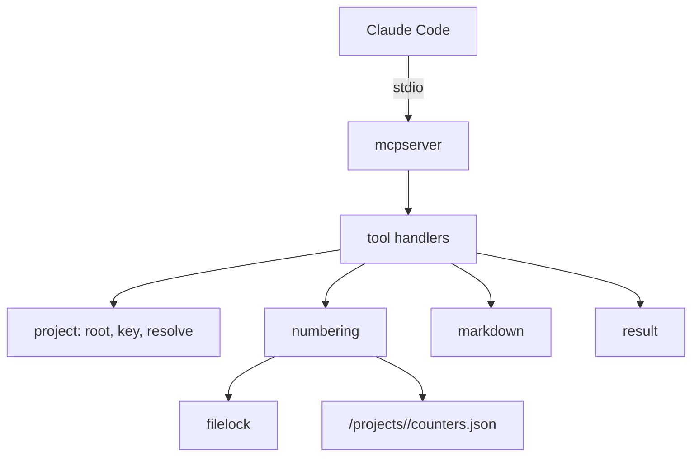

# TASK-004: MCP server core, project root and number allocation

| Field | Value |
| :--- | :--- |
| Type | `feat` |
| Owner | Maintainer |
| Reviewers | Maintainer |
| Platforms | macOS, Linux, Windows |
| Size | `M` (1–3 days) |
| Blocks | TASK-003, TASK-005, TASK-006, TASK-007, TASK-009, TASK-014, TASK-015 |
| Related | ADR-002, ADR-005, ADR-007 |

## Document History
| Date | Author | Description / Change Notes |
| :--- | :--- | :--- |
| 2026-10-25 | Claude | Initial draft specification from the design interview |
| 2026-10-25 | Equal | Open questions answered. Approved. |
| 2026-10-25 | Equal | Work started. |
| 2026-10-25 | Claude | Public API changed to the form in section 7.2. |
| 2026-10-25 | Equal | Done. All acceptance criteria pass. |

## 1. Summary
Add `claude-dx mcp`, a stdio MCP server with no tools yet, and the shared packages that all tools use: project root and path guard, project key, OS file lock, number allocation, Markdown helpers and compact result helpers.

## 2. Problem and Motivation
All tool tasks need the same base. If each tool makes its own base, the results are not consistent.

## 3. Goals
- G-1: Claude Code connects to `claude-dx mcp` and shows the server `dx` as connected.
- G-2: 20 parallel processes allocate 20 different numbers for one project.
- G-3: Each tool helper refuses a path outside the project root, also through `..` and symlinks.

## 4. Out of Scope
- Tools: TASK-005 and later.
- Update check: TASK-003.

## 5. Context
### 5.1 Current State
TASK-001 gives the layout.

### 5.2 Assumptions
- A-1: `github.com/modelcontextprotocol/go-sdk` supports stdio server transport and elicitation. Stdio verified with v1.8.0 (TASK-002 probe): Claude Code 2.1.308 connected and called a tool. Elicitation: verify in TASK-010.
- A-2: `golang.org/x/sys/windows` gives `LockFileEx`. Verify: package docs.

### 5.3 Constraints
- ADR-002, ADR-005, ADR-007.

## 6. Requirements
### 6.1 Functional
- FR-1: `claude-dx mcp` serves MCP on stdin and stdout with name `dx` and the binary version. Logs go to stderr only. Add `internal/plugin/assets/.mcp.json`: `{"mcpServers":{"dx":{"command":"{{BINARY}}","args":["mcp"]}}}`.
- FR-2: `project.Root()` returns `git rev-parse --show-toplevel`, or the current directory outside git.
- FR-3: `project.Key()` returns the first 16 hex characters of the SHA-256 of the absolute git common directory, or of the root outside git (ADR-007).
- FR-4: `project.Resolve(rel)` returns an absolute path inside the root, after it resolves `..` and symlinks. Else it returns an error: `Path <rel> is outside the project.`
- FR-5: `filelock.Lock(path)` takes an exclusive OS lock (`flock` on macOS and Linux, `LockFileEx` on Windows) and returns an unlock function.
- FR-6: `numbering.Next(kind, dir, pattern)` obeys ADR-007: mutex, file lock on `<cache>/projects/<key>/lock`, `max(counter, highest in dir) + 1`, and the caller creates the file with `O_EXCL` before the lock is released.
- FR-7: `markdown` parses and writes YAML frontmatter with `go.yaml.in/yaml/v3`, reads a section by its heading (`## 3. Goals` or `3`, `### 7.1` or `7.1`), and replaces a section with no change to other sections.
- FR-8: `result` helpers make compact text: aligned list lines, short messages in ASD-STE100.

### 6.2 Non-Functional
- NFR-1: The server starts in less than 100 ms.
- NFR-2: No data race (`go test -race`).

## 7. Design
### 7.1 Architecture


### 7.2 Public API
```text
project.Open(dir string) (Project, error)          // Project{Root, Key}
Project.Resolve(rel string) (string, error)
filelock.Lock(path string) (unlock func() error, err error)
numbering.Allocator{Dir}.Next(kind, docDir string, pattern *regexp.Regexp, create func(n int) error) (int, error)
numbering.Highest(dir string, pattern *regexp.Regexp) (int, error)
markdown.Split(src) (front, body string) / markdown.Join(front, body) string
markdown.Decode(front string, v any) error
markdown.SetField(front, key string, value any) string   // keeps the comment at the end of the line
markdown.Section(body, ref string) (string, bool)
markdown.ReplaceSection(body, ref, content string) (string, error)
mcpserver.New(version) *mcp.Server / mcpserver.Run(ctx, version) error
mcpserver.Text(text) / mcpserver.Errorf(format, args...) / mcpserver.Table(rows) string
```
`project.Open` takes a directory, so tests use temp repositories with no change of the process directory. The markdown functions work on strings, with no document type, because each tool needs only some of them.`numbering.Next` calls `create(n)` while it holds the lock, so the file exists before another process reads the directory.

### 7.3 Data and File Formats
```json
{"adr": 11, "task": 15}
```
File: `<cache>/projects/<key>/counters.json`.

### 7.4 User-facing Behavior
Not applicable.

### 7.5 Alternatives
- See ADR-007.

## 8. Implementation Plan
| Work batch | Files | Steps | Check |
| :--- | :--- | :--- | :--- |
| 1 | `internal/project/`, `internal/filelock/` | FR-2 to FR-5. Tests with temp repos, worktrees and symlinks. | `go test -race ./internal/project/ ./internal/filelock/` |
| 2 | `internal/numbering/` | FR-6. Test that starts 20 processes (the test binary) at the same time. | `go test -race ./internal/numbering/` |
| 3 | `internal/markdown/`, `internal/mcpserver/` (`result`) | FR-7, FR-8. Golden file tests. | `go test ./internal/markdown/` |
| 4 | `internal/mcpserver/`, `internal/cli/` | FR-1. Connect `mcp` command. | Session with `claude-dx`: `/mcp` shows `dx` connected |

## 9. Acceptance Criteria
- AC-1: Given a session started with `claude-dx`, when the user runs `/mcp`, then `dx` is connected.
- AC-2: Given 20 parallel allocations in two worktrees of one repository, when they finish, then the numbers are 20 different values.
- AC-3: Given `../x` or a symlink to `/etc`, when `Resolve` runs, then it returns the outside-project error.

## 10. Validation and Metrics
| Metric | Baseline | Target | How to measure |
| :--- | :--- | :--- | :--- |
| Server start time | None | < 100 ms | Time from start to the `initialize` response in a test |

- Tests: unit and process tests on the three platforms in CI.
- Platforms not verified: none.

## 11. Risks and Mitigations
| Risk | Impact | Mitigation |
| :--- | :--- | :--- |
| File lock on network file systems | Low | The cache is on a local disk (`os.UserCacheDir`) |

## 12. Removal and Compatibility
Not applicable. This is the base of all tools.

## 13. Open Questions
| ID | Question | Owner | Answer |
| :--- | :--- | :--- | :--- |
| Q-1 | YAML library for frontmatter. Recommended: `go.yaml.in/yaml/v3` (maintained fork of `gopkg.in/yaml.v3`). A small own parser is the alternative, but lists and quotes make it fragile. | Maintainer | Accepted: `go.yaml.in/yaml/v3`. |

The status cannot be `Approved` while a question is `Open`.

## 14. Definition of Done
- [x] All acceptance criteria pass, with evidence. AC-1: Claude Code 2.1.308 started with `claude-dx` shows `plugin:dx:dx` as `connected`. AC-2: `TestNextParallelProcesses` (20 processes, 2 worktree directories, 1 cache) gives 1 to 20 with no duplicates, in CI run 40230283887 on macOS, Linux and Windows. AC-3: `TestResolve` and `TestResolveRefusesSymlinkOutside` (symlink test skipped on Windows). NFR-1: initialize takes about 11 ms (`TestMCPServerInitialize`). NFR-2: `go test -race` passes.
- [x] Project checks (build, tests, lint) pass. CI run 40230283887; lint with GOOS=windows also passes.
- [x] Docs are updated. Section 7.2 has the final API.
- [x] The final Design diagrams that describe the code are in the docs of the area, with a link from this task. The flowchart in section 7.1 matches the code.
- [x] ADRs are recorded for architectural decisions. No new decision. ADR-002 and ADR-007 describe the code.
- [x] `/dx:eureka` is done. The tool does not exist yet. Lesson recorded as a code comment: `internal/project/project_test.go` (a global git config can sign commits with an external agent; tests disable it).
