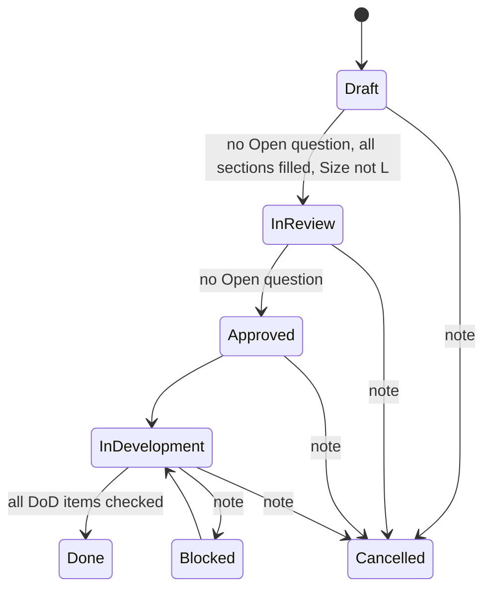

# TASK-006: Task tools and the /dx:task skill

| Field | Value |
| :--- | :--- |
| Type | `feat` |
| Owner | Maintainer |
| Reviewers | Maintainer |
| Platforms | macOS, Linux, Windows |
| Size | `M` (1–3 days) |
| Blocks | TASK-008 |
| Related | ADR-005, ADR-006, ADR-007, ADR-009 |

## Document History
| Date | Author | Description / Change Notes |
| :--- | :--- | :--- |
| 2026-10-25 | Claude | Initial draft specification from the design interview |
| 2026-10-25 | Equal | Open questions answered. Approved. |
| 2026-10-25 | Equal | Work started. |
| 2026-10-25 | Claude | FR-9 changed: `task_renumber` takes the file name and lists the tasks that refer to the old ID, because the old ID can name two files. The template is in `internal/docs/task/`. Shared file rules moved to `internal/docs/docfile`. |
| 2026-10-25 | Equal | Done. All acceptance criteria pass. NFR-1 measured with `BenchmarkList200`. |

## 1. Summary
Add the task tools of ADR-006, the generated `docs/tasks/INDEX.md` and the `/dx:task` skill. The tools enforce the status rules of the equal task skill.

## 2. Problem and Motivation
The task template has 14 sections. The model reads all of it to change one line, and status rules depend on the model. The tools let the model read and change one section, and they enforce the rules.

## 3. Goals
- G-1: `task_get(id, section)` returns only one section.
- G-2: `task_set_status` refuses a status change that breaks a rule, with the reason.
- G-3: Each task write makes `INDEX.md` again, in the format of `equal-tasks-index`.

## 4. Out of Scope
- Delete of tasks: ADR-006.
- Execution of tasks by agents: not part of dx.

## 5. Context
### 5.1 Current State
Reference: [equal `task` skill](https://github.com/is-equal/claude-equal-workflow/tree/main/plugins/equal/skills/task) and [`equal-tasks-index`](https://github.com/is-equal/claude-equal-workflow/blob/main/plugins/equal/bin/equal-tasks-index) (INDEX format).

### 5.2 Assumptions
- None.

### 5.3 Constraints
- ADR-006 template changes: no `Agent` column; Definition of Done uses "Project checks (build, tests, lint) pass" and `/dx:eureka`.

## 6. Requirements
### 6.1 Functional
- FR-1: `task_list(status?, priority?, area?)` returns one line for each task: `TASK-NNN <status> <priority> <title> [area] deps:<ids>`. Default: open tasks only. A warning line for each duplicate number.
- FR-2: `task_get(id, section?)` returns the full file or one section by number (`7.1`) or title.
- FR-3: `task_create(title, priority, area, depends_on, fields, sections)` allocates the number, makes `docs/tasks/` if necessary, fills the template, sets `status: Draft` and adds the first Document History row. `fields` holds the table values (type, owner, reviewers, platforms, size, blocks, related). `sections` maps a section number to its body. A section that is not given keeps the template text.
- FR-4: `task_update_section(id, section, body)` replaces one section.
- FR-5: `task_update_fields(id, fields)` changes frontmatter (title, priority, area, depends_on) and table values.
- FR-6: `task_set_status(id, status, note)` adds a Document History row with today's date, the author (Q-1) and the note, and enforces:
  - `In Review`: no `Open` question, no section with template text, Size is not `L`.
  - `Approved`: no `Open` question.
  - `Done`: all Definition of Done items are checked.
  - `Blocked`, `Cancelled`: `note` is required.
- FR-7: `task_question_add(id, question, owner)` adds the next `Q-n` row with `Open`. `task_question_answer(id, qid, answer)` writes the answer.
- FR-8: `task_dod_check(id, item, evidence)` checks one Definition of Done item and adds the evidence after it.
- FR-9: `task_renumber(file)` gives the task file the next free number and renames it. It lists the tasks that refer to the old ID and does not change them, because the old ID can name two files. The model changes each reference that means this task with `task_update_fields`.
- FR-10: Each write tool makes `INDEX.md` again: first line `<!-- Generated by claude-dx. Do not edit. -->`, then the equal format (priority and status tables, open tasks sorted by priority then ID, closed tasks with the closed date), with `/dx:task` in place of `/equal:task`.
- FR-11: The skill `/dx:task` has the Create, Refine and Change the status parts of the equal skill, changed to use the tools, `/dx:grill`, `/dx:glossary` and `dx:scout`. It tells the model not to read `INDEX.md`.

### 6.2 Non-Functional
- NFR-1: `task_list` on 200 tasks takes less than 50 ms.

## 7. Design
### 7.1 Architecture

Other changes (example: `In Review` back to `Draft`) are allowed with no rule.

### 7.2 Public API
```text
task_list(status?, priority?, area?) -> lines
task_get(id, section?) -> markdown
task_create(title, priority, area: [string], depends_on: [string], fields?: {...}, sections?: {"1": "..."}) -> message
task_update_section(id, section, body) -> message
task_update_fields(id, fields) -> message
task_set_status(id, status, note?) -> message or refusal with reasons
task_question_add(id, question, owner?) -> "Added Q-3."
task_question_answer(id, qid, answer) -> message
task_dod_check(id, item: int, evidence) -> message
task_renumber(file) -> message with the tasks that refer to the old ID
```

### 7.3 Data and File Formats
The changed equal task template (ADR-006). `INDEX.md` as in FR-10.

### 7.4 User-facing Behavior
`/dx:task` reports the task path, its status, its priority and the open questions.

### 7.5 Alternatives
- See ADR-006.

## 8. Implementation Plan
| Work batch | Files | Steps | Check |
| :--- | :--- | :--- | :--- |
| 1 | `internal/docs/task/template.md`, `internal/docs/task/` | Template changes. FR-1 to FR-5, FR-7, FR-8. Golden file tests. | `go test ./internal/docs/task/` |
| 2 | `internal/docs/task/` | FR-6, FR-9, FR-10. Rule tests; INDEX golden test against an output of `equal-tasks-index` for the same tasks. | `go test ./internal/docs/task/` |
| 3 | `internal/plugin/assets/skills/task/SKILL.md` | FR-11. | Session: create, refine and approve a task |

## 9. Acceptance Criteria
- AC-1: Given a task with one `Open` question, when `task_set_status(id, "Approved")` runs, then it refuses and names the question.
- AC-2: Given a task write, when it finishes, then `INDEX.md` is current.
- AC-3: Given no `docs/tasks/`, when `task_list` runs, then the result is `No tasks. docs/tasks does not exist.` and no directory is made.

## 10. Validation and Metrics
| Metric | Baseline | Target | How to measure |
| :--- | :--- | :--- | :--- |
| Characters read to change one section | Full file (~6000) | One section | Compare `task_get` results in a transcript |

- Tests: golden file and rule tests; one manual session.
- Platforms not verified: none.

## 11. Risks and Mitigations
| Risk | Impact | Mitigation |
| :--- | :--- | :--- |
| Users edit task files by hand and break the format | Medium | Tools report the parse error with the line number |

## 12. Removal and Compatibility
Delete `internal/docs/task/`, the template and the skill. Task files stay valid Markdown. `INDEX.md` stops updating.

## 13. Open Questions
| ID | Question | Owner | Answer |
| :--- | :--- | :--- | :--- |
| Q-1 | Author in Document History rows. Recommended: `git config user.name`; if it is empty, `Agent`. | Maintainer | Accepted: `git config user.name`; if it is empty, `Agent`. |

The status cannot be `Approved` while a question is `Open`.

## 14. Definition of Done
- [x] All acceptance criteria pass, with evidence. AC-1: `TestQuestions`. AC-2: `TestCreate`, `TestSetStatusRules` and `TestIndexMatchesRepository`. AC-3: `TestMissingDir`. CI run 40233280353 on macOS, Linux and Windows. Real session (Claude Code 2.1.308, Haiku, temporary repository): `task_create`, `task_question_add`, then `task_set_status(Approved)` refused with `Cannot set Approved: Q-1 is Open.`; the author came from `git config user.name`; `INDEX.md` was made. Metric: `task_get` with `section` returns only that section. NFR-1: `BenchmarkList200` gives approximately 13 ms for 200 tasks of 6 KB (Apple M1); target 50 ms.
- [x] Project checks (build, tests, lint) pass. CI run 40233280353; lint with GOOS=windows also passes.
- [x] Docs are updated (README tool list). Not applicable yet: the README lists features by version in Roadmap; a tool list comes with the v0.1 release notes.
- [x] The final Design diagrams that describe the code are in the docs of the area, with a link from this task. The status diagram in 7.1 describes the code (`internal/docs/task/change.go`). There are no area docs yet.
- [x] ADRs are recorded for architectural decisions. No new decision; ADR-006 and ADR-007 describe the code.
- [x] `/dx:eureka` is done. The tool does not exist yet. No new lesson: the FR-9 change is in the Document History.
