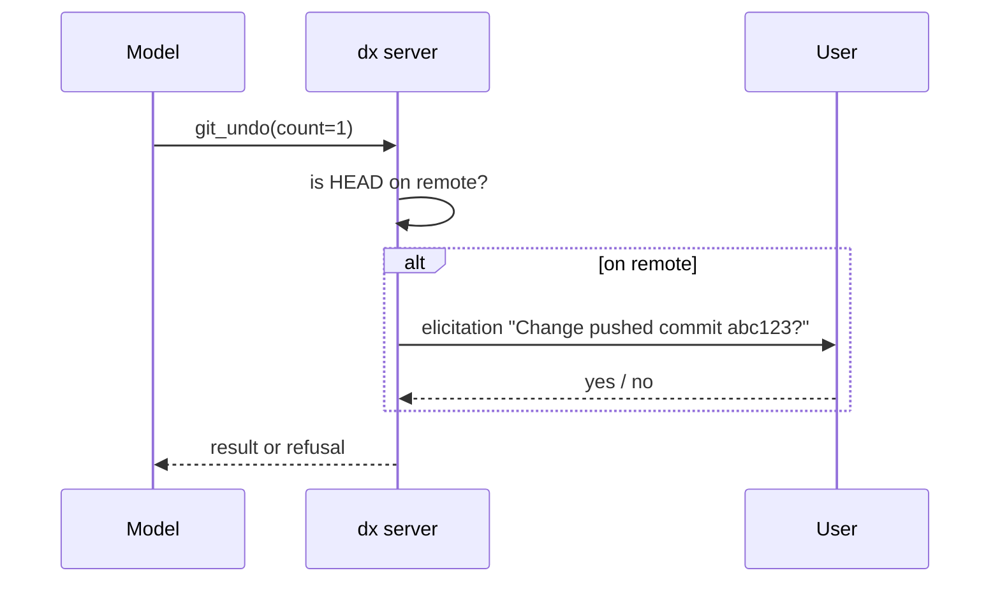

# TASK-010: Git tools for local changes and history

## Document History
| Date | Author | Description / Change Notes |
| :--- | :--- | :--- |
| 2026-10-25 | Claude | Initial draft specification from the design interview |
| 2026-10-25 | Equal | Open questions answered. Approved. |

## 1. Summary
Add the git tools that change local state: `git_stage`, `git_unstage`, `git_discard`, `git_commit`, `git_amend`, `git_undo`, `git_fixup`, `git_revert`, `git_cherry_pick`, `git_tag`, `git_stash`. Add the elicitation helper and the "commit is on the remote" check.

## 2. Problem and Motivation
Commits must be Conventional Commits. History changes must not change commits that are on the remote, unless the user authorizes it (ADR-008).

## 3. Goals
- G-1: `git_commit` refuses a message that is not a valid Conventional Commit, with the reason.
- G-2: `git_undo`, `git_amend` and `git_fixup` ask the user with elicitation before they change a commit that is on the remote.

## 4. Out of Scope
- Branch, sync, rebase, push: TASK-011.

## 5. Context
### 5.1 Current State
TASK-009 gives the runner.

### 5.2 Assumptions
- A-1: Claude Code supports MCP elicitation. Verify: a test tool that sends an elicitation request.
- A-2: `git rebase -i --autosquash` with `GIT_SEQUENCE_EDITOR=true` runs with no editor. Verify: test on git 2.30 and the latest git.

### 5.3 Constraints
- ADR-008.

## 6. Requirements
### 6.1 Functional
- FR-1: `git_stage(paths)`, `git_unstage(paths)`.
- FR-2: `git_discard(paths)` restores the paths from HEAD and removes untracked paths in the list. The tool description says it is destructive.
- FR-3: `git_commit(type, scope?, summary, body?, breaking?, paths?, co_authors?)` stages `paths` if given, builds the message of ADR-008, validates it and commits. If nothing is staged, it refuses.
- FR-4: `git_amend(message_fields?)` adds the staged changes to the last commit. With message fields, it builds and validates a new message.
- FR-5: `git_undo(count?)` runs `reset --soft HEAD~count` (default 1).
- FR-6: `git_fixup(commit)` makes a `fixup!` commit from the staged changes and runs an autosquash rebase onto the parent of `commit`.
- FR-7: `git_revert(commit)` makes a revert commit with a Conventional Commit message (`revert: <subject>`).
- FR-8: `git_cherry_pick(commits)`, `git_tag(name, message?, ref?)`, `git_stash(action, message?, index?)` with actions `push`, `pop`, `list`, `drop`.
- FR-9: The remote check: a commit is on the remote if a remote-tracking branch contains it (`git branch -r --contains`).
- FR-10: The elicitation helper asks the user a yes or no question. If the client does not support elicitation, or the user says no, the tool refuses with the reason. FR-4, FR-5 and FR-6 use it when FR-9 is true.

### 6.2 Non-Functional
- NFR-1: A refusal never changes the repository.

## 7. Design
### 7.1 Architecture


### 7.2 Public API
```text
git_commit(type, scope?, summary, body?, breaking?: bool, paths?: [string], co_authors?: [string]) -> "Committed abc1234 feat(cli): add update command"
git_amend(type?, scope?, summary?, body?, breaking?) -> message
git_undo(count?: int) -> message
git_fixup(commit) -> message
git_revert(commit) -> message
git_stage(paths) / git_unstage(paths) / git_discard(paths)
git_cherry_pick(commits: [string]) / git_tag(name, message?, ref?) / git_stash(action, message?, index?)
```

### 7.3 Data and File Formats
Commit message:
```text
feat(cli)!: add update command

Body in ASD-STE100.

BREAKING CHANGE: <text>
Co-Authored-By: Name <email>
```

### 7.4 User-facing Behavior
The elicitation dialog shows the commit hash, the subject and the effect.

### 7.5 Alternatives
- A `force` parameter that the model sets: rejected. The model can misread the user (Q-37).

## 8. Implementation Plan
| Work batch | Files | Steps | Check |
| :--- | :--- | :--- | :--- |
| 1 | scratch test tool | Verify A-1, A-2. | Manual session |
| 2 | `internal/git/commit.go`, `internal/git/message.go` | FR-1 to FR-3, FR-7, message validation table tests. | `go test ./internal/git/` |
| 3 | `internal/git/history.go`, `internal/mcpserver/elicit.go` | FR-4 to FR-6, FR-8 to FR-10. | `go test ./internal/git/` |

## 9. Acceptance Criteria
- AC-1: Given `summary: "Added X."`, when `git_commit` runs, then it refuses: not lowercase imperative, and a period at the end.
- AC-2: Given a pushed HEAD and a user that says no, when `git_undo` runs, then HEAD does not change.
- AC-3: Given `co_authors`, when `git_commit` runs, then the commit has one `Co-Authored-By:` trailer for each item.

## 10. Validation and Metrics
| Metric | Baseline | Target | How to measure |
| :--- | :--- | :--- | :--- |
| Invalid commit messages | Not measured | 0 | `git log` check in CI of this repository |

- Tests: temp repositories with a bare remote.
- Platforms not verified: none.

## 11. Risks and Mitigations
| Risk | Impact | Mitigation |
| :--- | :--- | :--- |
| A-1 is false | High | Refuse the exceptions; the user runs them by hand |
| Autosquash rebase stops on a conflict | Medium | Return the conflict list; the model uses `git_rebase` (TASK-011) |

## 12. Removal and Compatibility
Delete the files of the work batches.

## 13. Open Questions
| ID | Question | Owner | Answer |
| :--- | :--- | :--- | :--- |
| Q-1 | None. | — | — |

## 14. Definition of Done
- [ ] All acceptance criteria pass, with evidence.
- [ ] Project checks (build, tests, lint) pass.
- [ ] Docs are updated (README tool list).
- [ ] The final Design diagrams that describe the code are in the docs of the area, with a link from this task.
- [ ] ADRs are recorded for architectural decisions.
- [ ] `/dx:eureka` is done.
