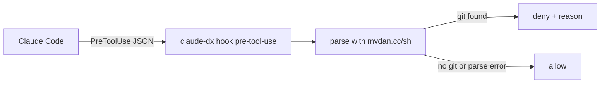

# TASK-012: Bash git hook, git_exec and the report command

| Field | Value |
| :--- | :--- |
| Type | `feat` |
| Owner | Maintainer |
| Reviewers | Maintainer |
| Platforms | macOS, Linux, Windows |
| Size | `M` (1–3 days) |
| Blocks | None |
| Related | ADR-008, ADR-009 |

## Document History
| Date | Author | Description / Change Notes |
| :--- | :--- | :--- |
| 2026-10-25 | Claude | Initial draft specification from the design interview |
| 2026-10-25 | Equal | Open questions answered. Approved. |

## 1. Summary
Add the `PreToolUse` hook that blocks git in the Bash tool, the `git_exec` tool for unmapped operations, the `unmapped.log` file and `claude-dx report`. Add the git rule to the shared rules.

## 2. Problem and Motivation
Without a block, the model uses Bash git and the result is not consistent. Without an escape, the block stops valid work. Unmapped operations must become visible so that the project can add tools (ADR-008).

## 3. Goals
- G-1: The hook blocks git in all the forms of FR-2.
- G-2: `git_exec` runs the command, logs it and tells the model to tell the user.
- G-3: `claude-dx report` opens a prefilled GitHub issue.

## 4. Out of Scope
- Blocking `mv`, `rm`, `cp`, `mkdir`: TASK-014.

## 5. Context
### 5.1 Current State
TASK-002 extracts `hooks/hooks.json` with `{{BINARY}}`.

### 5.2 Assumptions
- A-1: A `PreToolUse` hook gets the Bash command in the JSON on stdin (`tool_input.command`) and can deny the call with a JSON decision and a reason for the model. Verified on 2.1.308 (TASK-002 probe): stdin has `hook_event_name`, `tool_name` and `tool_input.command`; the output `{"hookSpecificOutput":{"hookEventName":"PreToolUse","permissionDecision":"deny","permissionDecisionReason":"<reason>"}}` stops the call, and the model gets `PreToolUse:Bash hook error: <reason>`.
- A-2: `mvdan.cc/sh/v3/syntax` parses the commands of the Bash tool on all platforms. Verify: tests.

### 5.3 Constraints
- ADR-008.

## 6. Requirements
### 6.1 Functional
- FR-1: `hooks/hooks.json` runs `{{BINARY}} hook pre-tool-use` for the `Bash` tool.
- FR-2: The hook parses the command and blocks it if a command name has the base name `git` (also `git.exe` and a full path). It checks lists (`;`, `&&`, `||`), pipes, subshells, command substitution, `sh -c` / `bash -c` / `zsh -c` strings (parsed again), `eval`, and the wrappers `env`, `command`, `exec`, `xargs`, `nohup`, `time`, `sudo`.
- FR-3: The deny reason: `Git in Bash is blocked. Use the git_* tools. If no tool fits, use git_exec.`
- FR-4: If the parser fails, the hook allows the command, so a parser bug does not stop work.
- FR-5: `git_exec(args, reason)` runs `git <args>` with the runner. The result has the git output and: `This git operation is not mapped. Tell the user. The user can run "claude-dx report" to open an issue.` It appends one JSON line to `<cache>/unmapped.log`.
- FR-6: `claude-dx report` reads `unmapped.log`, groups lines by the git subcommand, and opens the issue form `.github/ISSUE_TEMPLATE/unmapped-git-operation.yml` in the browser, prefilled with URL parameters (`template`, `title`, `operations`, `version`, `os`). It also prints the URL. `report --clear` empties the log. With an empty log it prints `No unmapped git operations.`
- FR-7: The rules text (TASK-008) gets: `Use the git_* tools for git. Do not run git in Bash.`

### 6.2 Non-Functional
- NFR-1: The hook runs in less than 30 ms.

## 7. Design
### 7.1 Architecture


### 7.2 Public API
```text
claude-dx hook pre-tool-use      (internal; stdin JSON, stdout JSON)
git_exec(args: [string], reason: string) -> output + notice
claude-dx report [--clear]
```

### 7.3 Data and File Formats
`unmapped.log`, one JSON object for each line:
```json
{"time":"2026-10-25T10:00:00Z","version":"v0.2.0","os":"darwin","args":["bisect","start"],"reason":"Find the commit that broke the test."}
```
The report does not include paths of the project. It includes only args, reason, version and OS. The user sees all content before submitting.

### 7.4 User-facing Behavior
```text
$ claude-dx report
3 unmapped git operations (bisect: 2, worktree: 1).
Opened https://github.com/EqualSoftware/claude-dx/issues/new?... in the browser.
```

### 7.5 Alternatives
- Permission deny rules: rejected (ADR-008).

## 8. Implementation Plan
| Work batch | Files | Steps | Check |
| :--- | :--- | :--- | :--- |
| 1 | `internal/hook/`, `internal/plugin/assets/hooks/hooks.json` | Verify A-1. FR-1 to FR-4. Table tests for each form of FR-2. | `go test ./internal/hook/` |
| 2 | `internal/git/exec.go`, `internal/cli/`, `internal/plugin/rules.md` | FR-5 to FR-7. | `go test ./internal/...`; session check |

## 9. Acceptance Criteria
- AC-1: Given `cd sub && bash -c "git push"`, when the hook runs, then it denies the call with the reason of FR-3.
- AC-2: Given `gh pr list`, when the hook runs, then it allows the call.
- AC-3: Given a `git_exec` call, when it finishes, then `unmapped.log` has one more line.

## 10. Validation and Metrics
| Metric | Baseline | Target | How to measure |
| :--- | :--- | :--- | :--- |
| Hook time | None | < 30 ms | Benchmark test |

- Tests: table tests; manual session.
- Platforms not verified: none.

## 11. Risks and Mitigations
| Risk | Impact | Mitigation |
| :--- | :--- | :--- |
| A form that the hook does not detect | Low | Add the form to the table tests when found |
| Arguments in the log contain secrets (example: a URL with a token) | Medium | Remove the user info part of URLs in `args` before the write |

## 12. Removal and Compatibility
Delete `internal/hook/`, `hooks.json`, `exec.go` and the `report` command.

## 13. Open Questions
| ID | Question | Owner | Answer |
| :--- | :--- | :--- | :--- |
| Q-1 | None. | — | — |

## 14. Definition of Done
- [ ] All acceptance criteria pass, with evidence.
- [ ] Project checks (build, tests, lint) pass.
- [ ] Docs are updated (README tool list).
- [ ] The final Design diagrams that describe the code are in the docs of the area, with a link from this task.
- [ ] ADRs are recorded for architectural decisions.
- [ ] `/dx:eureka` is done.
