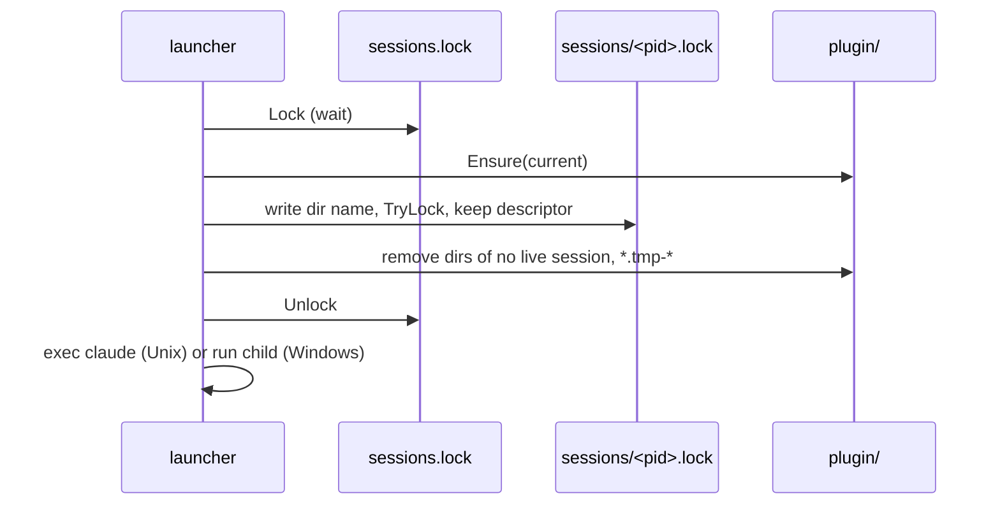

# TASK-041: Session locks for the plugin cache

## Document History

| Date | Author | Description / Change Notes |
| :--- | :--- | :--- |
| 2026-10-25 | Equal | Initial draft specification |
| 2026-10-26 | Equal | Refined with /dx:grill. The maintainer confirmed the same understanding. |

## 1. Summary

Each claude-dx session holds a lock file in `<cache>/sessions/`. The launcher removes the plugin directories that no session uses. `claude-dx cache clean` refuses to remove the cache while a session runs.

## 2. Problem and Motivation

`plugin.Ensure` (`internal/plugin/plugin.go:25`) makes one directory for each release and for each dev build with other assets (`dev-<key>`, TASK-027). No code removes the old directories, so the cache grows with each build. `cache.Clean` (`internal/cache/cache.go:23`) removes files that a running session can read later (the skills of its plugin directory).

## 3. Goals

- G-1: `<cache>/plugin` keeps only the directories that running sessions use, and the directory of the new session.
- G-2: `claude-dx cache clean` never removes the files of a running session.

## 4. Out of Scope

- The `doctor` output of the sessions.
- Other cache data (`update.json`, `projects/`).
- The session ID of Claude Code: the launcher does not know it.

## 5. Context
### 5.1 Current State

- Unix: `start` (`internal/launcher/exec_unix.go`) replaces the process with `syscall.Exec`. Go opens files with close-on-exec.
- Windows: `start` (`internal/launcher/exec_windows.go`) runs claude as a child and waits.
- `filelock.Lock` (`internal/filelock/filelock.go`) waits for an exclusive lock. It has no mode that does not wait.

### 5.2 Assumptions

- A-1: An OS file lock stays after `exec` when the descriptor does not have close-on-exec. Verify: a test that runs `exec` with the lock and tries the lock from another process.
- A-2: The OS releases the lock when the process ends, also after a crash.

### 5.3 Constraints

- ADR-001: the cache and the plugin directory.
- Tests pass on macOS, Linux and Windows.
- No new module dependency: `golang.org/x/sys` is already in `go.mod`.

## 6. Requirements
### 6.1 Functional

- FR-1: `filelock` gets `TryLock(path)`: it takes an exclusive lock with no wait and returns a sentinel error when another process holds it. Unix: `LOCK_EX|LOCK_NB`. Windows: `LOCKFILE_FAIL_IMMEDIATELY`.
- FR-2: Session file: `<cache>/sessions/<pid>.lock`. The name is the PID of the launcher (on Unix also the PID of claude after `exec`). The content is the name of the plugin directory of the session.
- FR-3: At start, the launcher holds the exclusive lock `<cache>/sessions.lock` (wait) and does these steps: `plugin.Ensure`, write and lock its session file, then the cleanup (FR-4). Then it releases `sessions.lock`. `Ensure` runs inside the lock, so the cleanup never removes the `*.tmp-*` directory of an extraction that runs.
- FR-4: Cleanup: for each session file, `TryLock`. If the lock is free, the session ended: remove the file. If it is held, keep its plugin directory. Then remove each directory in `<cache>/plugin` that no running session uses and that is not the new directory, and each `*.tmp-*` directory. Ignore the errors of the cleanup.
- FR-5: The session lock is released when the session ends, also after a crash, because the OS releases the lock of a process that ends. Unix: the session file descriptor has no close-on-exec, so claude holds the lock until it ends; the next start or `cache clean` removes the file. Windows: the launcher holds the descriptor until claude ends, then closes it and removes the file.
- FR-6: `claude-dx cache clean` holds `sessions.lock`, and checks all session files with `TryLock` before it removes a file. If a session holds its lock, the command removes nothing and fails with `a claude-dx session uses the cache (PID <pid>). Close it and try again.`

### 6.2 Non-Functional

- NFR-1: The start of a session adds no network call and only reads the small session files.

## 7. Design
### 7.1 Architecture

A new package `internal/session` has `Start(cacheDir, dirName)` and `Busy(cacheDir)`. The launcher calls `Start`. `cache clean` calls `Busy`.

### 7.2 Public API

`claude-dx cache clean`: new failure message (FR-6). No other CLI change.

### 7.3 Data and File Formats

- `<cache>/sessions.lock`: empty file, only for the lock.
- `<cache>/sessions/<pid>.lock`: one line, the plugin directory name, example `v0.1.0` or `dev-1a2b3c4d5e6f7a8b`.

### 7.4 User-facing Behavior

`claude-dx cache clean` with an open session prints the FR-6 message and exits with code 1.

### 7.5 Alternatives

- One shared lock in each plugin directory: rejected by the maintainer. Session files can be removed when a session ends with no cleanup, and need only an exclusive lock.
- A random session ID: rejected, the PID is enough because the lock is the source of truth.
- Remove only with `cache clean`: rejected, each dev build adds a directory.

## 8. Implementation Plan

| Work batch | Files | Steps | Check |
| :--- | :--- | :--- | :--- |
| 1 | `internal/filelock/filelock.go`, `internal/filelock/lock_unix.go`, `internal/filelock/lock_windows.go`, `internal/filelock/filelock_test.go` | FR-1. | `go test ./internal/filelock/` |
| 2 | `internal/session/` (new), `internal/launcher/launcher.go`, `internal/launcher/exec_unix.go` | FR-2 to FR-5. Test A-1 with a helper process. | `go test ./internal/session/ ./internal/launcher/` |
| 3 | `cmd/claude-dx/main.go`, `internal/cache/cache.go`, `cmd/claude-dx/main_test.go` | FR-6. | `go test ./cmd/claude-dx/ ./internal/cache/` |
| 4 | ADR (new), `README.md` | Record the session lock decision as an ADR. Describe the `cache clean` refusal. | Read the ADR |

## 9. Acceptance Criteria

- AC-1: Given a running session and an old plugin directory with no session, when a new session starts, then the old directory is removed and the directory of the running session stays.
- AC-2: Given a running session, when `claude-dx cache clean` runs, then it removes nothing and fails with the FR-6 message.
- AC-3: Given no running session, when `claude-dx cache clean` runs, then it removes the cache.
- AC-4: Given a session file of a process that ended, when a session starts, then the file is removed.
- AC-5 (Unix): Given a process that holds a session lock and runs `exec`, then the lock stays until the new program ends.

## 10. Validation and Metrics

| Metric | Baseline | Target | How to measure |
| :--- | :--- | :--- | :--- |
| Plugin directories with no session after a start | All old builds | 0 | AC-1 test |

- Tests: unit tests for each AC, with helper processes for the lock.
- Platforms not verified: none. CI runs on macOS, Linux and Windows. Manual check: two sessions on macOS.

## 11. Risks and Mitigations

| Risk | Impact | Mitigation |
| :--- | :--- | :--- |
| A child process of claude inherits the session descriptor and keeps the lock after claude ends | Low | The lock then shows a session that still has a process. The next start removes the file when the lock is free. |
| Windows refuses to remove a file in use | Low | FR-4 ignores the errors; the next start tries again. |
| A plugin directory of an older claude-dx version with no session file | Low | No session holds it, so the first start removes it. |

## 12. Removal and Compatibility

Delete `internal/session`, `TryLock` and their calls. The `sessions/` files stay in the cache until `cache clean`.

## 13. Open Questions

| ID | Question | Owner | Answer |
| :--- | :--- | :--- | :--- |
| Q-1 | How do the tools know that a session uses the cache? | Equal | A lock file `<cache>/sessions/<id>.lock` for each session (grill Q-18). |
| Q-2 | Remove old plugin directories at each start, or only with `cache clean`? | Equal | At each start too (grill Q-19). |
| Q-3 | `cache clean` with a running session: remove nothing, or remove the free parts? | Equal | Remove nothing and fail (grill Q-20). |
| Q-4 | File name, content and global lock. Recommended: the PID as name, the plugin directory as content, and `sessions.lock` for start and cleanup. | Equal | Yes (grill Q-21). |
| Q-5 | New package `internal/session`, `plugin.Ensure` inside `sessions.lock`, size M? | Equal | Yes. The lock must always be released when the session ends (grill Q-27). |
| Q-6 | Unix keeps `exec`, so no claude-dx code runs when the session ends. Is it enough that the OS releases the lock and the next start or `cache clean` removes the file? | Equal | Yes. On Windows, the launcher removes the file when claude ends (grill Q-31). |

The status cannot be `Approved` while a question is `Open`.

## 14. Definition of Done

- [ ] All acceptance criteria pass, with evidence.
- [ ] Project checks (build, tests, lint) pass.
- [ ] Docs are updated (`README.md`, cache section).
- [ ] The final Design diagrams that describe the code are in the docs of the area, with a link from this task.
- [ ] ADRs are recorded for architectural decisions (session locks).