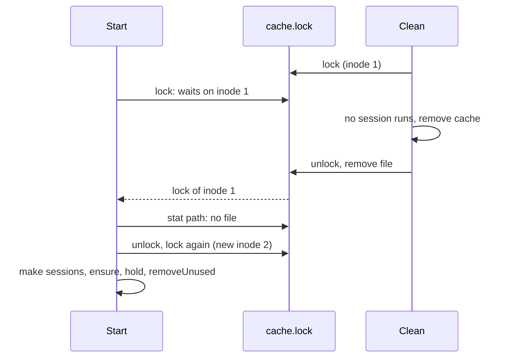

# TASK-051: Rename and check the cache lock

## Document History
| Date | Author | Description / Change Notes |
| :--- | :--- | :--- |
| 2026-10-26 | Equal | Initial draft specification |

## 1. Summary

The cache lock file is `<cache>/cache.lock`. A session start and `cache clean` lock it and then check that the path still has the locked file. So `cache clean` can remove the lock file, and a session start that waits for `cache clean` starts correctly.

## 2. Problem and Motivation

Found by the code review of 2026-10-26.
- `Start` (`internal/session/session.go:28`) makes `<cache>/sessions` before it takes the cache lock. `Clean` removes that directory. A start that waits for the lock during `cache clean` then fails in `hold` with `no such file or directory`, and `claude-dx` does not start.
- `Clean` removes `<cache>/sessions.lock` after it releases the lock (`internal/session/session.go:69`). On Unix, a start that waits holds the lock of the removed file. A second start makes a new `sessions.lock` and locks it. Then the two starts run `ensure` and `removeUnused` at the same time, and one start can remove the `*.tmp-*` extraction of the other.

## 3. Goals

- G-1: `cache clean` does not run while a session runs or starts.
- G-2: A session does not start while `cache clean` runs. A start that waits for `cache clean` starts after it.
- G-3: `cache clean` removes all files of the cache, also the lock file.
- G-4: The name of the lock file tells its purpose.

## 4. Out of Scope

- The session lock of each session (TASK-050).
- The numbering lock and the docs lock (ADR-007).

## 5. Context
### 5.1 Current State

- `Start` takes the cache lock with `filelock.Lock` after `os.MkdirAll` of `sessions`.
- `Clean` removes all files but the lock file with `cache.Clean`, releases the lock, then removes the lock file and the cache directory, because Windows cannot remove an open file.

### 5.2 Assumptions

- A-1: On Unix, a process that waits in `flock` on a file that another process removes gets the lock of the removed file. Verify: a test.
- A-2: On Windows, `os.Remove` of the lock file fails while another process has it open, because Go opens files with no `FILE_SHARE_DELETE` (learning `go-windows-file-sharing`). Verify: the Windows CI run of AC-2.

### 5.3 Constraints

- ADR-014: session lock files.
- Tests pass on macOS, Linux and Windows.

## 6. Requirements
### 6.1 Functional

- FR-1: The cache lock file is `<cache>/cache.lock`, not `<cache>/sessions.lock`, because the lock protects all of the cache, not only the session files.
- FR-2: `Start` and `Clean` lock `cache.lock`, then compare the locked file with the file at the path (`os.SameFile`). If the path has no file or another file, they release the lock and try again, because `Clean` removed the file while they waited. A-1 gives the reason.
- FR-3: `Start` makes `<cache>/sessions` after it has the lock, because `Clean` can remove that directory while `Start` waits. It makes the cache directory before the lock, because the lock file is in it.
- FR-4: `Clean` removes the cache, then releases the lock, then removes `cache.lock` and the cache directory. On Windows, if a start waits, the remove of `cache.lock` fails (A-2). Then `Clean` does not report that file as a failure, because the start uses it.
- FR-5: `Clean` refuses when a session runs (TASK-041). This does not change.

### 6.2 Non-Functional

- NFR-1: One more `os.Stat` and `File.Stat` for each lock, with no new process.

## 7. Design
### 7.1 Architecture

A function `lockCache(cacheDir)` in `internal/session/session.go` makes the cache directory, locks `cache.lock` in a loop until the locked file is the file at the path, and returns the unlock function. `Start` and `Clean` call it. `Start` makes `sessions` after the lock.

`filelock.Lock` returns only an unlock function. The check needs the locked file, so `filelock.Lock` also returns the `*os.File`, or `lockCache` uses `filelock.TryLock` in a blocking form. The developer selects the smaller change.

### 7.2 Public API

No change.

### 7.3 Data and File Formats

The cache lock file changes from `<cache>/sessions.lock` to `<cache>/cache.lock`. An old `sessions.lock` stays until `cache clean`. v0.1.0 is not released, so only `v0.1.0-rc.1` uses the old name.

### 7.4 User-facing Behavior

`claude-dx cache clean` removes all of the cache. A `claude-dx` that starts during `cache clean` waits, then starts with a new cache.

### 7.5 Alternatives

- Keep the lock file after `cache clean`: rejected, the user wants `cache clean` to remove all of the cache.
- Put the lock file outside the cache: rejected, the cache is the only directory of claude-dx.
- A start fails when `cache clean` runs: rejected, a wait is shorter for the user and `cache clean` takes little time.

## 8. Implementation Plan

| Work batch | Files | Steps | Check |
| :--- | :--- | :--- | :--- |
| 1 | `internal/filelock/` (only if FR-2 needs the locked file), `internal/session/session.go`, `internal/session/session_test.go`, `internal/session/session_unix_test.go` | FR-1 to FR-5, with tests. | `go test ./internal/filelock/ ./internal/session/` |
| 2 | ADR-014 (with `adr_update`), `docs/GLOSSARY.md` (with `glossary_upsert`) | The lock file name and the check after the lock. | `adr_get ADR-014`, `glossary_lookup Cache lock` |

## 9. Acceptance Criteria

- AC-1: Given `Clean` that removed the cache, when `Start` runs, then it passes and the session file exists.
- AC-2: Given `Clean` that ran with no waiting start, then the cache directory does not exist.
- AC-3 (Unix): Given a start that waits on `cache.lock` while `Clean` removes the file, when a second start runs, then the two starts do not hold the cache lock at the same time.
- AC-4: Given a running session, when `Clean` runs, then it refuses (TASK-041 AC-2 stays true).
- AC-5: Given `Start`, then the lock file is `<cache>/cache.lock`.

## 10. Validation and Metrics

| Metric | Baseline | Target | How to measure |
| :--- | :--- | :--- | :--- |
| Failed starts after `cache clean` | Possible | 0 | AC-1 test |
| Two holders of the cache lock | Possible on Unix | 0 | AC-3 test |

- Tests: unit tests for each AC, with helper processes for AC-3.
- Platforms not verified: none. CI runs on macOS, Linux and Windows.

## 11. Risks and Mitigations

| Risk | Impact | Mitigation |
| :--- | :--- | :--- |
| `v0.1.0-rc.1` and a new binary run at the same time and lock different files | Low | Only the release candidate has the old name. |
| On Windows, `cache.lock` stays after `cache clean` when a start waits | Low | The start uses the file. |

## 12. Removal and Compatibility

Revert the change, ADR-014 and the glossary row. The `lockCache` loop is in one function.

## 13. Open Questions
| ID | Question | Owner | Answer |
| :--- | :--- | :--- | :--- |
| — | None. | — | — |

The status cannot be `Approved` while a question is `Open`.

## 14. Definition of Done
- [ ] All acceptance criteria pass, with evidence.
- [ ] Project checks (build, tests, lint) pass.
- [ ] Docs are updated (area docs, `CLAUDE.md`).
- [ ] The final Design diagrams that describe the code are in the docs of the area, with a link from this task.
- [ ] ADRs are recorded for architectural decisions.
