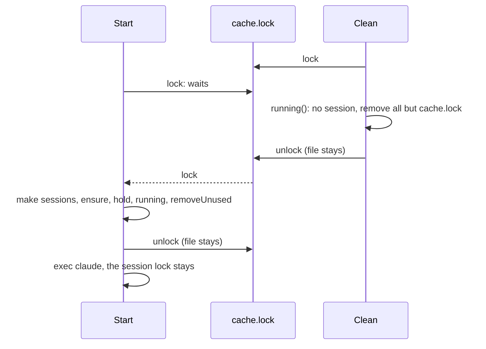

# TASK-051: Rename the cache lock and keep its file

## Document History

| Date | Author | Description / Change Notes |
| :--- | :--- | :--- |
| 2026-10-26 | Equal | Initial draft specification |
| 2026-10-26 | Equal | Replaced by ADR-015: a read-write cache lock with no session files, in the new tasks for the launcher and the cache lock. |

## 1. Summary

The cache lock file is `<cache>/cache.lock`, and no process removes it. A session start takes the cache lock before it makes `<cache>/sessions`. So a session does not open while `cache clean` runs, a start that waits for `cache clean` opens correctly after it, and many sessions run at the same time.

## 2. Problem and Motivation

Found by the code review of 2026-10-26.
- `Start` (`internal/session/session.go:28`) makes `<cache>/sessions` before it takes the cache lock. `Clean` removes that directory. A start that waits for the lock during `cache clean` then fails in `hold` with `no such file or directory`, and `claude-dx` does not start.
- `Clean` removes `<cache>/sessions.lock` after it releases the lock (`internal/session/session.go:69`). On Unix, a start that waits holds the lock of the removed file. A second start makes a new `sessions.lock` and locks it. Then the two starts run `ensure` and `removeUnused` at the same time, and one start can remove the `*.tmp-*` extraction of the other.

## 3. Goals

- G-1: `cache clean` does not run while a session runs or starts.
- G-2: A session does not open while `cache clean` runs. The start waits, then opens after `cache clean`.
- G-3: Many sessions of one project or of different projects run at the same time.
- G-4: Only one session start or `cache clean` holds the cache lock at a time, in all cases.
- G-5: The name of the lock file tells its purpose.

## 4. Out of Scope

- The session lock of each session (TASK-050).
- The numbering lock and the docs lock (ADR-007).

## 5. Context
### 5.1 Current State

- `Start` takes the cache lock with `filelock.Lock` after `os.MkdirAll` of `sessions`.
- `Clean` removes all files but the lock file with `cache.Clean`, releases the lock, then removes the lock file and the cache directory, because Windows cannot remove an open file.

### 5.2 Assumptions

- A-1: On Unix, a process that waits in `flock` on a file that another process removes gets the lock of the removed file. So the removal of a lock file that other processes lock gives two holders. Verify: a test.

### 5.3 Constraints

- ADR-014: session lock files.
- Tests pass on macOS, Linux and Windows.

## 6. Requirements
### 6.1 Functional

- FR-1: The cache lock file is `<cache>/cache.lock`, not `<cache>/sessions.lock`, because the lock protects all of the cache, not only the session files.
- FR-2: No process removes `cache.lock`. `cache clean` removes all other files and directories of the cache, and keeps `cache.lock` and the cache directory. A-1 gives the reason. The OS releases the lock when a process ends, so the file never keeps a lock after its process.
- FR-3: `Start` makes the cache directory, takes the cache lock with a blocking lock, then makes `<cache>/sessions`, because `cache clean` can remove `sessions` while `Start` waits.
- FR-4: A session start waits while `cache clean` or another start holds the cache lock. It does not fail, because the lock does not tell which process holds it, and two starts at the same time must both open.
- FR-5: `Clean` refuses when a session runs (TASK-041). This does not change.

### 6.2 Non-Functional

- NFR-1: No new system call. The cache lock stays held only for the start steps, not for the session.

## 7. Design
### 7.1 Architecture

- `Start` (`internal/session/session.go:27`): `os.MkdirAll(cacheDir)`, `filelock.Lock(cache.lock)`, then `os.MkdirAll(sessions)`.
- `Clean` (`internal/session/session.go:51`): `cache.Clean(cacheDir, lock)` keeps the lock file and its parent. The loop that removes the lock file and the cache directory goes away.

### 7.2 Public API

No change.

### 7.3 Data and File Formats

The cache lock file changes from `<cache>/sessions.lock` to `<cache>/cache.lock`. An old `sessions.lock` goes away at the next `cache clean`. v0.1.0 is not released, so only `v0.1.0-rc.1` uses the old name.

### 7.4 User-facing Behavior

`claude-dx cache clean` removes all of the cache but the empty file `cache.lock`. A `claude-dx` that starts during `cache clean` waits, then opens with a new cache.

### 7.5 Alternatives

- Remove `cache.lock` at the end of `cache clean`, and after each lock compare the locked file with the file at the path (`os.SameFile`): rejected, it needs a retry loop for one empty file, and on Windows the file stays when a start waits.
- Remove `cache.lock` at a session start: rejected, the same race as A-1.
- A start fails while `cache clean` runs: rejected, the lock does not tell which process holds it, so two starts at the same time also fail. A marker file of `cache clean` adds state that a crash can leave.
- A lock with exclusive create (`O_EXCL`), as git `index.lock`: rejected, a crash leaves the file and stops all starts.

## 8. Implementation Plan

| Work batch | Files | Steps | Check |
| :--- | :--- | :--- | :--- |
| 1 | `internal/session/session.go`, `internal/session/session_test.go`, `internal/session/session_unix_test.go` | FR-1 to FR-5, with tests. | `go test ./internal/session/` |
| 2 | ADR-014 (with `adr_update`), `docs/GLOSSARY.md` (with `glossary_upsert` for `Cache lock` and `Cache`) | The lock file name and the rule that no process removes it. | `adr_get ADR-014`, `glossary_lookup Cache lock` |

## 9. Acceptance Criteria

- AC-1: Given `Clean` that removed the cache, when `Start` runs, then it passes and the session file exists.
- AC-2: Given `Clean` that ran, then the cache has only `cache.lock`.
- AC-3: Given a process that holds the cache lock, when `Start` runs, then it waits, and it passes after the process releases the lock.
- AC-4: Given a running session, when `Clean` runs, then it refuses (TASK-041 AC-2 stays true).
- AC-5: Given two `Start` calls of different processes at the same time, then both pass and both session files exist.
- AC-6: Given `Start`, then the lock file is `<cache>/cache.lock`.

## 10. Validation and Metrics

| Metric | Baseline | Target | How to measure |
| :--- | :--- | :--- | :--- |
| Failed starts after `cache clean` | Possible | 0 | AC-1 test |
| Removals of the cache lock file | Each `cache clean` | 0 | AC-2 test |
| Failed starts at the same time | 0 | 0 | AC-5 test |

- Tests: unit tests for each AC, with helper processes for AC-3 and AC-5.
- Platforms not verified: none. CI runs on macOS, Linux and Windows.

## 11. Risks and Mitigations

| Risk | Impact | Mitigation |
| :--- | :--- | :--- |
| `v0.1.0-rc.1` and a new binary run at the same time and lock different files | Low | Only the release candidate has the old name. |
| A user thinks that `cache clean` did not remove all files | Low | `cache.lock` is empty, and ADR-014 gives the reason. |

## 12. Removal and Compatibility

Revert the change, ADR-014 and the glossary rows.

## 13. Open Questions
| ID | Question | Owner | Answer |
| :--- | :--- | :--- | :--- |
| — | None. | — | — |

The status cannot be `Approved` while a question is `Open`.

## 14. Definition of Done
- [ ] All acceptance criteria pass, with evidence.
- [ ] Project checks (build, tests, lint) pass.
- [ ] Docs are updated (area docs, `CLAUDE.md`).
- [ ] The final Design diagrams that describe the code are in the docs of the area, with a link from this task.
- [ ] ADRs are recorded for architectural decisions.
