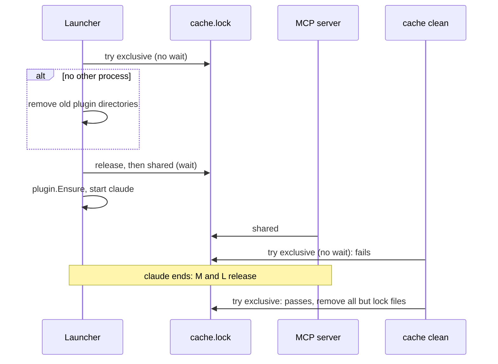

# TASK-061: Use a read-write cache lock

## Document History

| Date | Author | Description / Change Notes |
| :--- | :--- | :--- |
| 2026-10-26 | Equal | Initial draft specification |
| 2026-10-26 | Equal | Status: In Review. |
| 2026-10-26 | Equal | Status: Approved. |

## 1. Summary

The read-write cache lock `<cache>/cache.lock` of ADR-015 replaces the session files of ADR-014. Each claude-dx process that uses the cache holds a shared lock, and `cache clean` needs the exclusive lock.

## 2. Problem and Motivation

Found by the code review of 2026-10-26 and the lock review of TASK-051:
- `Start` makes `<cache>/sessions` before the lock (`internal/session/session.go:28`), so a start that waits for `cache clean` fails.
- `Clean` removes `sessions.lock` after the unlock (`internal/session/session.go:69`), so on Unix two processes can hold the cache lock.
- A PID check finds a running session (TASK-050), and a reused PID keeps an ended session as running.
- `cache clean` removes `projects/<key>/docs.lock`, which an MCP server can hold.

## 3. Goals

- G-1: `cache clean` never runs while a claude-dx process uses the cache.
- G-2: No session opens while `cache clean` runs. The start waits, then opens.
- G-3: Many sessions run at the same time.
- G-4: No PID check and no session file.
- G-5: No process removes a lock file.

## 4. Out of Scope

- The shared docs lock for read tools: a separate task.
- The plugin directory name (TASK-055).

## 5. Context
### 5.1 Current State

- ADR-014: session files, `sessions.lock`, PID check.
- `filelock` has only an exclusive lock (`internal/filelock/lock_unix.go:12`).
- Users of the cache: the launcher (`internal/launcher/launcher.go:32`), the MCP server (`internal/mcpserver/server.go:29`), `update` and `doctor` (`cmd/claude-dx/main.go:85`, `cmd/claude-dx/main.go:128`), `cache clean` (`cmd/claude-dx/main.go:109`).

### 5.2 Assumptions

- A-1: `flock` with `LOCK_SH` and `LockFileEx` with no `LOCKFILE_EXCLUSIVE_LOCK` give a shared lock that many processes hold, and an exclusive lock waits for all of them. Verify: a filelock test with helper processes.
- A-2: Go opens files with close-on-exec, so a child of the launcher does not get the cache lock. Verify: AC-7.

### 5.3 Constraints

- ADR-015.
- Depends on the task that runs claude as a child process on Unix.
- Tests pass on macOS, Linux and Windows.

## 6. Requirements
### 6.1 Functional

- FR-1: `filelock` gives a shared and an exclusive lock, each in a blocking and a no-wait form.
- FR-2: The launcher makes the cache directory, tries the exclusive lock of `<cache>/cache.lock` with no wait, and if it gets it, removes each plugin directory but its own, and the `*.tmp-*` directories. Then it releases it.
- FR-3: The launcher takes the shared lock with a wait, then calls `plugin.Ensure`, because `cache clean` can remove the plugin between the two locks. It holds the shared lock until claude ends.
- FR-4: `cache clean` takes the exclusive lock with no wait. If it fails, it returns "a claude-dx session uses the cache. Close it and try again". Else it removes all of the cache but the lock files `cache.lock` and `projects/*/docs.lock`, because no process removes a lock file (ADR-015).
- FR-5: The code of the session files goes away: `<cache>/sessions/`, `running`, `alive`, `hold`, `inherit`.
- FR-6: The MCP server holds the shared lock while it runs. `update` and `doctor` hold it during the command.

### 6.2 Non-Functional

- NFR-1: Two lock calls at start, one at the start of the MCP server. No PID check.

## 7. Design
### 7.1 Architecture

`internal/session` keeps `Start` (cleanup and shared lock) and `Clean`. The plugin directory of a session is known from `plugin.DirName`.

### 7.2 Public API

No change of the commands.

### 7.3 Data and File Formats

- New: `<cache>/cache.lock`. Removed: `<cache>/sessions/` and `<cache>/sessions.lock`.
- After `cache clean`, the cache has `cache.lock` and the `projects/<key>/docs.lock` files.

### 7.4 User-facing Behavior

`claude-dx cache clean` with a running session gives "a claude-dx session uses the cache. Close it and try again", with no PID. A start during `cache clean` waits a short time.

### 7.5 Alternatives

See ADR-015 Alternatives.

## 8. Implementation Plan

| Work batch | Files | Steps | Check |
| :--- | :--- | :--- | :--- |
| 1 | `internal/filelock/lock_unix.go`, `internal/filelock/lock_windows.go`, `internal/filelock/*_test.go` | FR-1, with tests. | `go test ./internal/filelock/` |
| 2 | `internal/session/session.go`, `internal/session/inherit_unix.go`, `internal/session/inherit_windows.go`, `internal/session/*_test.go`, `internal/launcher/launcher.go` | FR-2 to FR-5, with tests. Remove the session files, `running`, `alive`, `hold` and `inherit`. | `go test ./internal/session/ ./internal/launcher/` |
| 3 | `internal/mcpserver/server.go`, `cmd/claude-dx/main.go`, their tests | FR-6. | `go test ./internal/mcpserver/ ./cmd/claude-dx/` |
| 4 | `docs/GLOSSARY.md` (with `glossary_upsert` and `glossary_delete`) | Change `Cache lock` and `Cache`. Delete `Session lock`. ADR-015 already supersedes ADR-014. | `glossary_lookup Cache lock` |

## 9. Acceptance Criteria

- AC-1: Given a process that holds a shared cache lock, when `cache clean` runs, then it fails with "a claude-dx session uses the cache" and removes nothing.
- AC-2: Given `cache clean` that holds the exclusive lock, when a session starts, then it waits, and it opens after `cache clean`.
- AC-3: Given two sessions that start at the same time, then both open.
- AC-4: Given one session that runs, when a second session starts, then the old plugin directories stay. Given no other process, when a session starts, then only its plugin directory stays.
- AC-5: Given `cache clean` that ran, then the cache has only `cache.lock` and the `docs.lock` files.
- AC-6: Given a running MCP server, when `cache clean` runs, then it fails.
- AC-7 (Unix): Given a session whose claude started a child that stays after claude ends, when `cache clean` runs after the end of the session, then it passes.

## 10. Validation and Metrics

| Metric | Baseline | Target | How to measure |
| :--- | :--- | :--- | :--- |
| `cache clean` while a session runs | 0 | 0 | AC-1, AC-6 tests |
| Failed starts after `cache clean` | Possible | 0 | AC-2 test |
| Ended sessions that block `cache clean` | Possible (reused PID, child) | 0 | AC-7 test |

- Tests: unit tests with helper processes for each AC.
- Platforms not verified: none. CI runs on macOS, Linux and Windows.

## 11. Risks and Mitigations

| Risk | Impact | Mitigation |
| :--- | :--- | :--- |
| Old plugin directories stay while sessions overlap | Low | The next start with no other process removes them. |
| A `v0.1.0-rc.1` session runs with a new binary | Low | Only the release candidate uses the old files. The next `cache clean` removes them. |
| The launcher dies (`kill -9`) while claude runs | Low | The MCP server holds a shared lock while claude runs. |

## 12. Removal and Compatibility

Revert the change and ADR-015. The removed session code comes back with the revert.

## 13. Open Questions
| ID | Question | Owner | Answer |
| :--- | :--- | :--- | :--- |
| — | None. | — | — |

The status cannot be `Approved` while a question is `Open`.

## 14. Definition of Done
- [ ] All acceptance criteria pass, with evidence.
- [ ] Project checks (build, tests, lint) pass.
- [ ] Docs are updated (area docs, `CLAUDE.md`).
- [ ] The final Design diagrams that describe the code are in the docs of the area, with a link from this task.
- [ ] ADRs are recorded for architectural decisions.
