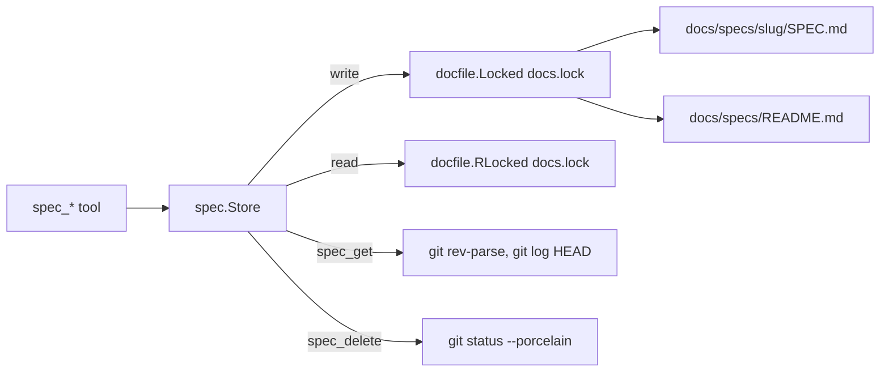

# TASK-063: Spec documents and spec tools

## Document History

| Date | Author | Description / Change Notes |
| :--- | :--- | :--- |
| 2026-10-26 | Equal | Initial draft specification |
| 2026-10-26 | Equal | Refined with /dx:grill: Q-2 to Q-28. |
| 2026-10-26 | Equal | The user approved the task in the chat. |
| 2026-10-26 | Equal | Status: In Development. |
| 2026-10-26 | Equal | All DoD items have evidence. CI run 40388269185 passes on macOS, Linux and Windows. |

## 1. Summary

Add the spec documents of ADR-016 in `docs/specs/<slug>/SPEC.md` and the `spec_*` MCP tools.

## 2. Problem and Motivation

Task files in git make too many files and do not give the current behavior of a feature (ADR-016).

## 3. Goals

- G-1: A spec gives the current definition of one feature, with requirements `R-N` and their status.
- G-2: The gates of ADR-013 apply to specs.
- G-3: `spec_get` gives the commits of each requirement from the `Refs: <slug>#R-N` trailers.
- G-4: The model can use the spec tools: a `dx:spec` skill, the plugin rules and the glossary terms Spec and Requirement.

## 4. Out of Scope

- Local tasks and the Task glossary term (TASK-064).
- `claude-dx resume`, the hook and the Resume glossary term (TASK-066).
- Migration of docs/tasks, the removal of the old parts of `dx:task`, the `CLAUDE.md` change and a new ADR for the task part of ADR-006 (TASK-067).
- Removal of a requirement or a `Removed` status (Q-9). It needs a change of ADR-016.
- Code shared between `internal/docs/task` and `internal/docs/spec` (Q-12).

## 5. Context
### 5.1 Current State

- `docs/specs/` does not exist. The glossary has no Spec or Requirement term (`docs/GLOSSARY.md:36` has only Task).
- Task tools: `internal/docs/task`. Template `template.md`, embedded at `task.go:22`. Protected sections `change.go:30-44` (refusal `section %q changes only with <tools>`, `change.go:40`). Scope sections and the change to In Review `change.go:58`, `change.go:77-82`. Status rules `change.go:248-305`, template text check `change.go:289-295`. Question table `change.go:18`, `change.go:333-421`. Document History `task.go:281-290`: date from `Store.Now` or `time.Now`, author from `git config user.name` (`mcpserver/server.go:76-82`), fallback `Agent`.
- Each write holds the docs lock with `docfile.Locked` (`docfile/write.go:24`), reads use `docfile.RLocked` (`write.go:32`). The lock path is `<project data dir>/docs.lock` (`mcpserver/server.go:38`).
- Each package writes its own index with `docfile.Write` (`task/index.go:52`, `adr/index.go:22`, `learning/index.go:25`). `TestIndexMatchesRepository` (`task/task_test.go:449`) compares the generated index with the committed file.
- `internal/mcpserver/server.go:28-45` registers each Store.
- Git: `project.go:58-61` runs `exec.Command("git", "-C", dir, "rev-parse", flag)`. No code runs `git log`.
- Kebab-case regex: `learning/learning.go:20`, error text `learning.go:174`.
- MCP tests: `mcpserver/server_test.go:30` (`connect`) makes a git repository with user.name `Tester` (`:41-42`). Package helpers, for example `adr/tools_test.go:12`.

### 5.2 Assumptions

- A-1: `git` is in `PATH` on the CI runners of macOS, Linux and Windows. Verify: `mcpserver/server_test.go:41` runs git and passes in CI.
- A-2: `git log --format` gives the values of one trailer key with `%(trailers:key=Refs,valueonly)`. Verify: a test with a commit that has two `Refs:` lines and one comma list.

### 5.3 Constraints

- ADR-016: the spec format, the tools and the Refs trailer. The tools run git directly.
- ADR-013: the gates (no Open question for Approved; a scope change of an Approved document sets In Review).
- ADR-015: the docs lock protects each write.
- ADR-017: no change of a pushed ADR (Q-22).
- No new dependency.

## 6. Requirements

- R-1: `spec_create` makes `docs/specs/<slug>/SPEC.md` from an embedded template, status `Draft`, Document History row "Initial draft specification". The slug is kebab-case `^[a-z0-9]+(-[a-z0-9]+)*$`, 40 characters or less, not `general`, and not an existing spec. Title: `docfile.CheckNewTitle`. Milestone `vX.Y.Z`. Priority P0 to P3. `related`: ADR IDs that exist (Q-11, Q-13).
- R-2: The tools `spec_list`, `spec_get` (all, or one section by number or title), `spec_update_section`, `spec_set_status`, `spec_req_add`, `spec_req_set`, `spec_question_add`, `spec_question_answer` and `spec_delete` exist.
- R-3: `spec_set_status` allows `Draft` -> `In Review` -> `Approved`, `In Review` -> `Draft`, `Approved` -> `In Review`. `Approved` needs no `Open` question. `In Review` refuses a section with the template text (Q-17).
- R-4: A change of section 3, 4, 5, 6 or 7 of an `Approved` spec sets it to `In Review`: `spec_update_section`, `spec_req_add`, and `spec_req_set` with a text change. `spec_question_add` on an `Approved` spec also sets `In Review`. A status change of a requirement does not (Q-8, Q-17).
- R-5: `spec_update_section` refuses section 5 (`spec_req_add`, `spec_req_set`), 8 (`spec_question_add`, `spec_question_answer`) and 9 (Document History) (Q-18).
- R-6: Each write holds the docs lock (ADR-015) and writes `docs/specs/README.md` again. Each read holds the shared docs lock.
- R-7: `spec_get` of the full spec or of section 5 adds a `Commits` column to the Requirements table and a list `hash subject` of the commits of `HEAD` with a trailer `Refs: <slug>#R-N`, newest first. Many `Refs:` lines and comma lists are valid; other values are ignored. With no `HEAD`, there are no commits. Other git failures give `git log failed: <error>` (Q-6, Q-7, Q-16, Q-24).
- R-8: `spec_req_add` adds `R-<highest + 1>` with status `Planned`. `spec_req_set` changes the text, the status (`Planned` or `Done`), or both. Both add a Document History row (Q-26).
- R-9: `spec_delete(slug, reason, move_to?, discard_files?)` deletes the folder and writes the index again. It refuses changes that are not committed, other files with no `move_to` or `discard_files`, both arguments together, and a file name collision in `move_to`. The reply gives the reason for the commit message (Q-5, Q-10, Q-25).
- R-10: `spec_list` filters by status, milestone, priority, area and related. Default: all specs. Each line: slug, status, priority, milestone, title, area, `Done/Total` (Q-15).
- R-11: A `dx:spec` skill, the plugin rules, the README link and the glossary terms Spec and Requirement (Q-2, Q-3, Q-19, Q-20, Q-21).

## 7. Design
### 7.1 Architecture

New package `internal/docs/spec`. It copies the needed logic of `internal/docs/task` and shares no code with it (Q-12). It uses `docfile` (lock, write, title, cell), `markdown` (frontmatter, sections) and `result`. `internal/mcpserver/server.go` registers its Store with the project root, the lock path and the author, as for tasks.



- Files: `spec.go` (Store, read, edit, history), `create.go`, `change.go` (sections, status, requirements, questions), `delete.go`, `commits.go` (git), `index.go`, `tools.go`, `template.md`.
- No threads. Each tool call is one lock hold. git runs inside the lock only in `spec_delete`, so a write cannot occur between the check and the delete. `spec_get` runs `git log` after the read lock, because git data does not change with the docs.

### 7.2 Public API

```text
spec_create(slug, title, milestone, priority, area[], related[], split_from?) -> "Created <slug>."
spec_list(status?, milestone?, priority?, area?, related?) -> lines
spec_get(slug, section?) -> text (with commits for full or section 5)
spec_update_section(slug, section, body) -> "Updated section N of <slug>." [+ In Review note]
spec_set_status(slug, status, note?) -> "<slug> is <status>."
spec_req_add(slug, text) -> "Added R-n." [+ In Review note]
spec_req_set(slug, rid, text?, status?) -> "Updated R-n." [+ In Review note]
spec_question_add(slug, question, owner?) -> "Added Q-n." [+ "Q-n is Open, so <slug> is In Review. The user must approve it again."]
spec_question_answer(slug, qid, answer) -> "Answered Q-n."
spec_delete(slug, reason, move_to?, discard_files?) -> "Deleted <slug>. Give this reason in the commit message: <reason>"
```

`split_from` gives the old slug of a split; the first Document History row is "Initial draft specification. Split from <slug>." (Q-32).

Texts that have a task counterpart copy the task text with spec in place of task (Q-23). Refusals with no counterpart (Q-27, Q-30, Q-31): `spec "x" does not exist`, `spec "x" exists`, `slug "general" is reserved`, `slug "X" is not kebab-case. Example: docs-lock`, `the slug has N characters. The limit is 40. Write a shorter slug`, `related "ADR-9": ADR-009 does not exist`, `requirement R-n does not exist`, `give the text of the requirement`, `give text, status or both`, `give the reason`, `the argument move_to must be another spec`, `file "a.svg" exists in docs/specs/y`, `the folder docs/specs/x has other files: a.svg, b.png. Give move_to or discard_files`, `give move_to or discard_files, not both`, `the folder docs/specs/x has changes that are not committed. Commit them first`, `git log failed: <error>`, `git status failed: <error>`, `section 5 has no requirement. Add one with spec_req_add`. No breaking change.

### 7.3 Data and File Formats

`docs/specs/<slug>/SPEC.md` (Q-18). The heading is the title, with no slug (Q-28):

```markdown
---
slug: docs-lock
title: Docs lock
status: Draft
milestone: v0.1.0
priority: P1
area: [docs]
related: [ADR-015]
---

# Docs lock

## 1. Summary
## 2. Problem
## 3. Goals
## 4. Out of Scope
## 5. Requirements
| ID | Requirement | Status |
| :--- | :--- | :--- |
| R-1 | Each write holds the docs lock. | Planned |
## 6. Design
## 7. Acceptance Criteria
## 8. Open Questions
| ID | Question | Owner | Answer |
## 9. Document History
| Date | Author | Description / Change Notes |
```

- Sections 1 to 4, 6 and 7 have placeholder text in the template. Section 6 asks for ADR links. Sections 5 and 8 start with a `None.` row.
- Other files of the spec are in the same folder.
- Commit trailer: `Refs: docs-lock#R-1` or `Refs: docs-lock#R-1, docs-lock#R-2`.
- `docs/specs/README.md`: columns `Slug (link) | Title | Status | Milestone | Priority | Area | Requirements` (`Done/Total`), order by milestone, then slug (Q-14). Header in the form of the other indexes.
- No migration: `docs/specs/` is new.

### 7.4 User-facing Behavior

The user and the model see the tool replies of 7.2, the `docs/specs/README.md` index, the `dx:spec` skill (Q-21) and the new lines of `rules.md` (Q-20). No CLI change.

### 7.5 Alternatives

- Shared code with `internal/docs/task`: TASK-064 and TASK-067 remove the task gates and question tools, so a shared layer is deleted soon (Q-12).
- `git log --all`: it shows commits of branches that are not merged (Q-6).
- An error when git log fails in a repository with no commit: a new repository is a valid state (Q-24).
- Delete a spec with changes that are not committed: git cannot restore them (Q-5, Q-25).
- Split R-7 into a new task: it is one git call and part of the `spec_get` contract (Q-4).

## 8. Implementation Plan

| Work batch | Files | Steps | Check |
| :--- | :--- | :--- | :--- |
| 1 | `internal/docs/spec/spec.go`, `create.go`, `template.md`, `index.go`, `tools.go`, `spec_test.go`, `internal/mcpserver/server.go`, `server_test.go`, `docs/specs/README.md` | Store with read and edit under the docs lock, history row, slug check, `spec_create`, `spec_list`, `spec_get` (no commits), index and its repository test. Register the Store. Add the tool names to `TestToolNames`. | `go test ./internal/docs/spec/... ./internal/mcpserver/...` |
| 2 | `internal/docs/spec/change.go`, `tools.go`, `change_test.go` | `spec_update_section` (protected and scope sections), `spec_set_status` (transitions, Open question, template text), `spec_req_add`, `spec_req_set`, `spec_question_add`, `spec_question_answer`. | `go test ./internal/docs/spec/...` |
| 3 | `internal/docs/spec/commits.go`, `delete.go`, `tools.go`, `commits_test.go`, `delete_test.go` | `git rev-parse --verify -q HEAD`, `git log HEAD` with the Refs trailer, Commits column and list. `spec_delete` with `git status --porcelain`, `move_to`, `discard_files`. Tests make a git repository with commits that have trailers. | `go test -race ./internal/docs/spec/...` |
| 4 | `internal/plugin/assets/skills/spec/SKILL.md`, `internal/plugin/assets/rules.md`, `README.md`, `docs/GLOSSARY.md` (with `glossary_upsert`) | `dx:spec` skill (Q-21), rules lines (Q-20), README link, terms Spec and Requirement (Q-19). | `go test ./internal/plugin/...` and the checks of `CLAUDE.md` |

## 9. Acceptance Criteria

- R-1 to R-6, R-8, R-10: MCP end-to-end tests of each tool, each gate and each refusal text of 7.2.
- R-7: a test git repository with commits: two `Refs:` lines, one comma list, one value of another slug, one value that is not valid. A test with no commit gives no commits and no error.
- R-9: tests for the delete, `move_to`, `discard_files`, both arguments, a collision, other files with no argument, a modified file and an untracked file.
- R-11: the plugin tests find the `dx:spec` skill; `glossary_lookup` finds Spec and Requirement.
- `docs/specs/README.md` matches the generated index.
- Tests pass on macOS, Linux and Windows (CI).

## 10. Validation and Metrics

| Metric | Baseline | Target | How to measure |
| :--- | :--- | :--- | :--- |
| git processes for one `spec_get` with commits | 0 | 2 (`rev-parse`, `log`) | Test that counts the commands, or a code review of `commits.go` |
| Spec tools with an end-to-end test | 0 | 10 of 10 | `go test ./internal/docs/spec/...` |

- Tests: unit and MCP end-to-end tests in `internal/docs/spec`, `go test -race` for the lock paths.
- Platforms not verified: None. Windows and Linux run in CI after the push.

## 11. Risks and Mitigations

| Risk | Impact | Mitigation |
| :--- | :--- | :--- |
| `git log` over a long history is slow | Low | One process, `--format` with the trailer only; measure in a test repository |
| The copy of the task logic and the task code get different behavior before TASK-067 | Low | TASK-067 removes the task gates; tests in both packages |
| A delete loses the other files of a spec | Medium | Refuse other files with no `move_to` or `discard_files`, and refuse changes that are not committed |
| `%(trailers)` format differs between git versions | Low | A test with the CI git on three platforms |

## 12. Removal and Compatibility

To remove: delete `internal/docs/spec/`, `internal/plugin/assets/skills/spec/`, `docs/specs/`, the registration in `internal/mcpserver/server.go`, the tool names in `server_test.go`, the spec lines of `rules.md` and `README.md`, and the glossary terms. No effect on tasks, ADRs or learnings. No existing data changes.

## 13. Open Questions

| ID | Question | Owner | Answer |
| :--- | :--- | :--- | :--- |
| Q-1 | spec_get (R-7) and claude-dx resume (TASK-066) need git log and git status. The git runner is TASK-009 in v0.2.0. Do we move TASK-009 to v0.1.0, or run git directly as internal/project/project.go:57 does? | Maintainer | Run git directly, as internal/project/project.go:57 does. The git runner of TASK-009 can replace it later. |
| Q-2 | Scope: does TASK-063 add the glossary terms Spec and Requirement (ADR-016 follow-up)? Task and Resume go to TASK-064 and TASK-066. | Maintainer | Yes. TASK-063 adds Spec and Requirement. TASK-064 adds Task, and TASK-066 adds Resume. |
| Q-3 | Scope: does TASK-063 add a dx:spec skill and the spec rules in the plugin rules, or does TASK-067 do all plugin skill and rule changes? | Maintainer | TASK-063 adds a dx:spec skill (create, refine with /dx:grill, change status) and the spec tools in the plugin rules. TASK-067 removes the old parts of dx:task. |
| Q-4 | Size: keep TASK-063 as one task of size M (11 tools, index, git log), or split R-7 (commits from Refs trailers) into a new task? | Maintainer | Keep one task, size M. R-7 stays in TASK-063. |
| Q-5 | spec_delete: what does it delete, and what does the reason do? The tools do not commit, and ADR-016 says the reason goes to the commit message. | Maintainer | spec_delete deletes the full folder docs/specs/slug/ and writes the index again. The reason is required; the reply gives it as text for the commit message. It refuses when the folder has changes that are not committed. Before the delete, the other files of the spec (diagrams, designs) must be available for a new spec. Q-10 gives how. |
| Q-6 | R-7: which commits does spec_get read: the history of HEAD only, or all branches (git log --all)? What does it show for each commit? | Maintainer | The history of HEAD only. For each commit: short hash and subject, newest first. |
| Q-7 | R-7: which trailer forms are valid: one requirement for each Refs line, and also a comma list (Refs: slug#R-1, slug#R-2)? | Maintainer | Both forms: many Refs lines, and a comma list in one line. A value that is not slug#R-n is ignored. |
| Q-8 | spec_req_set: what can it change (text, status), and which change of an Approved spec sets In Review? | Maintainer | spec_req_set changes the text, the status (Planned or Done), or both. Only a text change of an Approved spec sets In Review. Both changes add a Document History row. |
| Q-9 | Requirement removal: is there a way to remove a requirement that the feature does not need now? ADR-016 gives only the status Planned and Done, and an R-N ID does not change. | Maintainer | No removal in TASK-063. To drop a requirement, change its text (the spec goes to In Review) or delete the spec. The next ID is the highest ID + 1, so an ID is never used again. A Removed status needs a change of ADR-016. |
| Q-10 | spec_delete: how does it keep the other files of the spec for a new spec? Option: an optional argument move_to (slug of an existing spec) that moves all files except SPEC.md to that folder before the delete, and refuses on a file name collision. | Maintainer | spec_delete has an optional argument move_to (slug of an existing spec). It moves all files except SPEC.md to that folder, then deletes the folder. It refuses when the target spec does not exist or a file name exists in the target. When the spec has other files, it refuses with the list of files, unless move_to or discard_files: true is given. |
| Q-11 | Slug rule: which slugs are valid, and what is the maximum length? | Maintainer | Kebab-case ^[a-z0-9]+(-[a-z0-9]+)*$ (as internal/docs/learning/learning.go:20), 40 characters or less. general is reserved. Error: slug "X" is not kebab-case. Example: docs-lock |
| Q-12 | Architecture: a new package internal/docs/spec that copies the needed logic of internal/docs/task (protected sections, question table, gates), or shared code extracted from internal/docs/task? | Maintainer | A new package internal/docs/spec. It copies the needed logic of internal/docs/task (protected sections, question table, gates, embedded template) and uses docfile, markdown and result. internal/mcpserver/server.go registers it. No shared code is extracted, because TASK-064 and TASK-067 remove the task question tools and task gates. |
| Q-13 | spec_create: which arguments, and which checks? | Maintainer | Arguments: slug, title, milestone, priority, area, related. Title: docfile.CheckNewTitle. Milestone: vX.Y.Z (task/milestone.go:11). Priority: P0 to P3. related: only ADR IDs that exist. Status Draft, Document History row "Initial draft specification". |
| Q-14 | Index docs/specs/README.md: which columns and which order? | Maintainer | Columns: Slug (link) \| Title \| Status \| Milestone \| Priority \| Area \| Requirements (Done/Total). Order: milestone, then slug. A test compares the index with the repository, as TestIndexMatchesRepository does. |
| Q-15 | spec_list: which filters, and which specs by default? | Maintainer | Filters: status, milestone, priority, area, related. Default: all specs. Each line: slug, status, priority, milestone, title, area, Done/Total. |
| Q-16 | spec_get commits: where does the reply show them, and what happens when git log fails (no git repository, git not installed)? | Maintainer | The reply adds a Commits column to the Requirements table (short hashes), then a list "hash subject". This is in the full spec_get and in spec_get of the Requirements section. The file does not change. If git log fails, spec_get fails with "git log failed: error". |
| Q-17 | Gates: does spec_req_add or spec_question_add on an Approved spec set In Review? Does In Review refuse a section that has the template text, as task_set_status does? | Maintainer | Yes. spec_req_add and spec_question_add on an Approved spec set In Review. In Review refuses a section with the template text, with the same message as tasks. |
| Q-18 | SPEC.md template: section order, numbers, protected sections and scope sections. | Maintainer | Sections: 1. Summary, 2. Problem, 3. Goals, 4. Out of Scope, 5. Requirements, 6. Design, 7. Acceptance Criteria, 8. Open Questions, 9. Document History. spec_update_section refuses 5 (spec_req_add, spec_req_set), 8 (spec_question_add, spec_question_answer) and 9. Scope sections: 3, 4, 5, 6, 7. Design has no fixed subsections, only a placeholder that asks for ADR links. Requirements starts as the table ID \| Requirement \| Status with a None. row. |
| Q-19 | Glossary text of Spec and Requirement. | Maintainer | Spec: "The current definition of one feature or scope, in docs/specs/<slug>/SPEC.md. Its ID is the slug. It has requirements and no task IDs." Requirement: "One behavior that a spec requires. Its ID R-N does not change. Its status is Planned or Done." TASK-064 changes the Task term. |
| Q-20 | Changes to other files: plugin rules.md, README.md, and the Refs trailer rule for commits. | Maintainer | rules.md: add specs to lines 2 and 4; add docs/specs and spec_list to line 5; add the line "A commit gives the requirements that it implements in a trailer Refs: <slug>#R-N." README.md: add "- Specs: [docs/specs/](docs/specs/)" near line 79. CLAUDE.md changes only in TASK-067. |
| Q-21 | Content of the dx:spec skill. | Maintainer | A short skill in the form of dx:task: (1) when to use it; (2) create with spec_create, then /dx:grill on goals, scope, requirements, design (ADR links; a new approach needs an ADR) and acceptance; (3) protected sections and their tools; (4) status gates, the user approves; (5) requirement IDs do not change, and the Refs trailer; (6) delete or split with move_to, the new spec gives the old slug in its Document History, the reason goes to the commit. |
| Q-22 | ADR-006 (document tools) and ADR-007: does TASK-063 change them? ADR-017 forbids a change of a pushed ADR. | Maintainer | No change to ADR-006 or ADR-007. ADR-016 is the decision for specs, and ADR-019 supersedes ADR-007. TASK-067 supersedes the task part of ADR-006 with a new ADR. |
| Q-23 | Reply texts of the spec tools: copy the task tool texts with spec in place of task? | Maintainer | Yes. Copy the task tool texts with spec in place of task. |
| Q-24 | spec_get in a repository with no commit (HEAD does not exist): error, or no commits? | Maintainer | No commits and no error. Before git log, run git rev-parse --verify -q HEAD; exit code 1 means no commits. All other failures give "git log failed: error". |
| Q-25 | spec_delete of a spec that is not committed (new files are untracked): refuse, or delete? | Maintainer | Refuse: "docs/specs/slug has changes that are not committed. Commit them first". Untracked files are changes that are not committed. The user deletes a draft spec that is not committed by hand. |
| Q-26 | Requirement tools: arguments, defaults, replies and Document History notes. | Maintainer | spec_req_add(slug, text): status Planned, reply "Added R-n.", history "Added R-n.". spec_req_set(slug, rid, text?, status?): refuses with "give text, status or both" when both are empty; reply "Updated R-n."; history "R-n: text changed." and/or "R-n: status Done.". The text is one line, escaped with docfile.Cell. spec_question_add and spec_question_answer work as the task tools, owner default Maintainer. |
| Q-27 | Refusal texts of the spec tools that have no task counterpart. | Maintainer | spec "x" does not exist (also for move_to); spec "x" exists; slug "general" is reserved; requirement R-n does not exist; move_to must be another spec; file "a.svg" exists in docs/specs/y; docs/specs/x has other files: a.svg, b.png. Give move_to or discard_files; give move_to or discard_files, not both. |
| Q-28 | Final check: lock and git order, package files, SPEC.md heading, spec_create reply, git process metric. | Maintainer | Approved: git status in the lock for spec_delete, git log after the read lock for spec_get; the package files of 7.1; the reply "Created slug."; 2 git processes for spec_get. Change: the SPEC.md heading is "# Title", with no slug. |
| Q-29 | Implementation: In Review with no requirement, texts of In Review after spec_question_add, template placeholder texts, index header, spec_set_status note, reply when docs/specs does not exist. | Maintainer | (a) In Review refuses a spec with no requirement: "section 5 has no requirement. Add one with spec_req_add". (b) spec_question_add on Approved: history "Status: In Review. Q-n is Open.", reply "Added Q-n. Q-n is Open, so slug is In Review. The user must approve it again."; spec_req_add and spec_req_set use the task text and add the rows "Added R-n." and "Status: In Review. The scope changed in section 5.". (c) The placeholders of the chat (task template style), None rows in sections 5 and 8. (d) The index header of the chat, one table ordered by milestone, then slug. (e) spec_set_status has an optional note, default "Status: X.". (f) When docs/specs does not exist: normal reply "No specs. docs/specs does not exist." |
| Q-30 | Implementation texts: empty delete reason, empty requirement text, slug too long, related ADR that does not exist, git status failure in spec_delete. | Maintainer | Yes: "give the reason"; "give the text of the requirement"; "the slug has N characters. The limit is 40. Write a shorter slug"; "related "ADR-9": ADR-009 does not exist"; "git status failed: error". |
| Q-31 | result.Sentence makes the first letter capital. Three texts start with a path or an argument name (docs/specs/x, move_to). Rewrite them? | Maintainer | Yes: "the folder docs/specs/x has changes that are not committed. Commit them first", "the folder docs/specs/x has other files: ... Give move_to or discard_files", "the argument move_to must be another spec". The shared docfile text "X has the same title" does not change. |
| Q-32 | ADR-016: a new spec from a split gives the old slug in its Document History. Document History is protected. Which tool writes that row? | Maintainer | spec_create has an optional argument split_from (the old slug). The first row is "Initial draft specification. Split from slug.". The tool does not check that the old spec exists, because it can be deleted. |

The status cannot be `Approved` while a question is `Open`.

## 14. Definition of Done

- [x] All acceptance criteria pass, with evidence.
  - Evidence: CI run 40388269185 at 70f13a3 passes: test on macos-latest, ubuntu-latest and windows-latest, install on the three platforms, vuln. The acceptance criteria tests are in internal/docs/spec.
- [x] Project checks (build, tests, lint) pass.
  - Evidence: At d4a5437 on macOS: go build, go vet (also GOOS=windows and GOOS=linux), go test -race ./... pass; golangci-lint v2.15.0: 0 issues; govulncheck: No vulnerabilities found.
- [x] Docs are updated (area docs, `CLAUDE.md`).
  - Evidence: d4a5437: README.md Specs link, internal/plugin/assets/rules.md spec lines and Refs trailer rule, skills/spec/SKILL.md, skills/grill/SKILL.md, GLOSSARY terms Spec and Requirement. CLAUDE.md changes in TASK-067 (Q-20).
- [x] The final Design diagrams that describe the code are in the docs of the area, with a link from this task.
  - Evidence: Not applicable (user approval in the chat): the project has no area docs folder. The diagram is in section 7.1; TASK-067 moves it to the spec at migration.
- [x] ADRs are recorded for architectural decisions.
  - Evidence: ADR-016 (Accepted) is the decision for specs. No new architecture decision; the task part of ADR-006 goes to TASK-067 (Q-22).