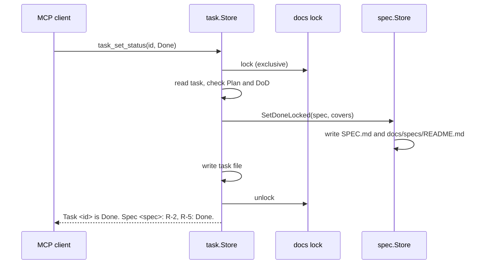

# TASK-064: Local tasks in the project data dir

## Document History

| Date | Author | Description / Change Notes |
| :--- | :--- | :--- |
| 2026-10-26 | Equal | Initial draft specification |
| 2026-10-26 | Equal | Grill done: Q-3 to Q-37 answered. The user confirms the same understanding and size M. |
| 2026-10-26 | Equal | The user approves the task in the chat. |
| 2026-10-26 | Equal | Status: In Development. |
| 2026-10-26 | Equal | Definition of Done item 4 removed (The final Design diagrams that describe the code are in the docs of the area, with a link from this task.): No area doc exists for tasks. TASK-067 moves the diagram of section 7.1 to the spec of local tasks. |
| 2026-10-26 | Equal | Status: Done. |

## 1. Summary

Move the task tools to local tasks in `<git-common-dir>/dx/tasks/<spec>/<task-slug>.md` (ADR-016). A task is a full brief with a Plan. `task_move` and `task_delete` change many tasks at once, and `spec_delete` refuses while a spec has tasks.

## 2. Problem and Motivation

Task files in git make too many files and number collisions between branches (ADR-016).

## 3. Goals

- G-1: Tasks are local, shared by all worktrees, with no counter.
- G-2: Many processes can change tasks and specs at the same time with no lost write and no corrupt file.
- G-3: A `Done` task sets its requirements to `Done` in the spec.

## 4. Out of Scope

- Spec tools (TASK-063).
- `claude-dx resume` and the `SessionStart` hook (TASK-066).
- `claude-dx clean` (TASK-069).
- The move of the project data from the cache to `<git-common-dir>/dx/` (TASK-068, Done).
- The removal of `docs/tasks` and the migration texts (TASK-067).

## 5. Context
### 5.1 Current State

- The task tools are in `internal/docs/task`. `Register` adds 13 tools (`internal/docs/task/tools.go:122`).
- `task_create` and `task_renumber` get a number from `numbering.Allocator.Next` (`internal/numbering/numbering.go:25`, called at `internal/docs/task/create.go:72` and `change.go:591`). The counter is in `project.json` (`numbering.go:16`).
- `Store.WriteIndex` writes `docs/tasks/README.md` (`internal/docs/task/index.go:52`).
- The spec store has the requirement statuses `Planned` and `Done`. `Store.SetRequirement` changes a requirement (`internal/docs/spec/change.go:196`). `Store.addHistory` adds a Document History row (`internal/docs/spec/spec.go:249`).
- Spec writes hold the exclusive docs lock with `docfile.Locked` (`internal/docs/spec/spec.go:211`). Reads hold the shared lock (`internal/docs/spec/tools.go:84`). The MCP server sets the lock path to `<data dir>/docs.lock` (`internal/mcpserver/server.go:39`).
- `Project.DataDir` gives `<git-common-dir>/dx` in git, else `<cache>/projects/<key>` (`internal/project/data.go:20`). `Project.MoveData` moves `project.json` and `tasks/` from the cache to `<git-common-dir>/dx` (`internal/project/data.go:15`, `:34`). The launcher calls it in the exclusive cache lock (`internal/launcher/launcher.go:74`).
- The dx:task skill (`internal/plugin/assets/skills/task/SKILL.md`), the dx:grill skill (`internal/plugin/assets/skills/grill/SKILL.md:40-47`) and the scout agent (`internal/plugin/assets/agents/scout.md:6`) name the task tools.

### 5.2 Assumptions

- A-1: All worktrees of a repository have the same git common directory. Verify: `git rev-parse --git-common-dir` in a worktree gives the `.git` of the main worktree (`internal/project/project.go:19-20`).
- A-2: `docfile.Write` replaces a file atomically on macOS, Linux and Windows, so a crash leaves the old or the new file, not a part of it. Verify: the current spec and task writes use it (`internal/docs/spec/spec.go:225`).

### 5.3 Constraints

- Before this task is installed, the open tasks of `docs/tasks` (TASK-065, TASK-066, TASK-067, TASK-069) become Draft specs, made with the spec tools (Q-3).
- Tests pass on macOS, Linux and Windows.
- Accepted ADRs that apply: ADR-015 (docs lock, project data directory), ADR-016 (specs and local tasks), ADR-019 (number allocation).

## 6. Requirements

- R-1: Path `tasks/<spec>/<task-slug>.md` in the project data directory (ADR-015), or `tasks/general/` for a task with no spec. ID `<spec>/<task-slug>`. All worktrees of a repository see the same tasks.
- R-2: Frontmatter `id`, `title`, `status`, `priority`, `covers`, `depends_on`. Sections Brief, Plan (checklist), Notes, Definition of Done. A task is a full brief: a subagent can do it with no other context. The title has no uniqueness rule (Q-14, Q-32, Q-35).
- R-3: Status `Todo`, `In Progress`, `Blocked`, `Done`. Allowed changes: `Todo` to `In Progress` or `Blocked`; `In Progress` to `Todo`, `Blocked` or `Done`; `Blocked` to `Todo` or `In Progress`. `Done` is final: all task tools refuse a change of a `Done` task, except `task_move` and `task_delete` (Q-12, Q-20).
- R-4: `depends_on` refuses a task of another spec, a missing task, the same task and a cycle.
- R-5: `covers` refuses a requirement that the spec does not have, and accepts a requirement that is `Done`. A `general` task has no `covers` (Q-30).
- R-6: `task_set_status` to `Done` needs all Plan steps and all Definition of Done items checked (Q-13). It sets the `covers` requirements to `Done` in the spec and adds the spec Document History row "R-2, R-5: Done." with the date and git user.name (Q-15). It writes the spec first and then the task, so a retry after a failure is safe (Q-9).
- R-7: `task_set_status` to `In Progress` needs all `depends_on` tasks `Done`, and an `Approved` spec, except for a `general` task (Q-10, Q-24). `Blocked` needs a note. For the other statuses the note is optional. The tool adds "<status>: <note>" to Notes (Q-12, Q-34).
- R-8: New tools `task_step_check`, `task_move` and `task_delete`. Remove `task_renumber`, `task_question_add`, `task_question_answer`, the task counter and the task index (Q-8). The old task counter stays in `project.json` with no clean-up code (Q-25).
- R-9: `task_move(ids, to)` and `task_delete(ids)` take one or more tasks and check all of them before any change. `task_delete` refuses a missing id and a task out of the set that depends on a task of the set. `task_move` needs tasks of one spec, refuses a dependency between specs and a slug that the target spec has, accepts `general` as source or target, changes `id` and `depends_on`, removes `covers` and adds "Moved from <old>. Old covers: R-2, R-5." to Notes. A retry accepts as moved an id that is in the target with this Notes line. Both remove an empty `tasks/<spec>/` folder (Q-17, Q-23, Q-29, Q-30).
- R-10: `spec_delete` refuses while `tasks/<slug>/` of the project data directory has a `.md` file. The spec package does not import the task package (Q-23, Q-30).
- R-11: Task writes hold the docs lock of the project data directory, as spec writes do, so one lock protects a task and its spec. `SetDoneLocked` also writes `docs/specs/README.md` (Q-37).
- R-12: `task_list(spec, status)` gives one line per task: id, status, priority, title. Order: spec slug (`general` last), status (`In Progress`, `Blocked`, `Todo`, `Done`), priority, id (Q-14, Q-27).
- R-13: The dx:task skill describes local tasks: creation from the requirements of a spec, a full Brief, a Plan with a check for each step, the status flow, `task_step_check`, the DoD tools, `task_move` and `task_delete`. Refinement, grill and scope approval are in dx:spec. The dx:grill skill and the scout agent name only the task tools that exist (Q-4, Q-36).

## 7. Design
### 7.1 Architecture

- `internal/project` exports the constants `DocsLock = "docs.lock"` and `Tasks = "tasks"`. `dataNames` uses `Tasks` (Q-23).
- `internal/mcpserver` builds the docs lock path with `project.DocsLock`, and gives the task store `Dir = <data dir>/tasks` and the spec store.
- `internal/docs/task` imports `internal/docs/spec` in one direction only, as a foreign key in the child table. `internal/docs/spec` does not import `internal/docs/task`. It finds the tasks of a spec at `filepath.Join(filepath.Dir(Lock), project.Tasks, slug)` (Q-23).
- Each task tool that writes holds the exclusive docs lock once, and in it calls the spec methods with the suffix `Locked` (the Go convention for "the caller holds the lock"). Reads hold the shared docs lock (ADR-015).
- No goroutines. Each MCP call reads and writes the files and keeps no state.



### 7.2 Public API

Go:

```go
// internal/project
const DocsLock = "docs.lock"
const Tasks = "tasks"

// internal/docs/spec: the caller holds the docs lock.
func (s Store) RequirementsLocked(slug string) (status string, rids []string, err error)
func (s Store) SetDoneLocked(slug string, rids []string) error

// internal/docs/task
type Store struct {
	Dir   string     // <data dir>/tasks
	Specs spec.Store // spec reads and writes; Specs.Author gives the spec row author
	Lock  string     // path of the docs lock; required
}
```

MCP tools (breaking change: the task ID is `<spec>/<task-slug>`, not `TASK-NNN`):

```text
task_list(spec?, status?) -> one line per task: id | status | priority | title, or "No tasks."
task_get(id, section?) -> the task file, or one section
task_create(spec, slug, title, priority, brief, plan[], covers[]?, depends_on[]?) -> "Created task <id>."
task_update_section(id, section: Brief | Plan | Notes, body) -> "Updated section <section> of <id>."
task_update_fields(id, title?, priority?, covers[]?, depends_on[]?) -> "Updated task <id>."
task_set_status(id, status, note?) -> "Task <id> is <status>." For Done: "Task <id> is Done. Spec <spec>: R-2, R-5: Done." For a general task: "Task <id> is Done."
task_step_check(id, step) -> "Checked step <n> of <id>."
task_dod_check(id, item, evidence) | task_dod_uncheck(id, item) | task_dod_add(id, text) | task_dod_remove(id, item, reason): as now, with the new ID
task_move(ids[], to) -> "Moved <n> tasks to <to>."
task_delete(ids[]) -> "Deleted <n> tasks."
```

- `task_dod_uncheck` has no reason. An uncheck hides nothing. The agent writes a reason in Notes with `task_update_section`.
- `task_dod_remove` adds a Notes line: "- Definition of Done item <n> removed (<text>): <reason>". A removal makes the Definition of Done weaker, so the reason is required.
- Each Notes line that a tool adds is a list item, for example "- Blocked: <note>". A move with no covers adds "- Moved from <old>.".
- A retry of `task_move` removes the old file when the new file has the Notes line "- Moved from <old>." (Q-43).
- A general task gets "The work of the Brief is done, with evidence." as its first Definition of Done item (Q-42). A task with covers gets "The covered requirements pass their acceptance criteria, with evidence."

Removed: `task_renumber`, `task_question_add`, `task_question_answer`. Removed `task_create` and `task_update_fields` fields: `milestone`, `type`, `size`, `owner`, `platforms`, `area`, `related`.

Changed: `spec_delete` refuses while the spec has tasks (R-10).

### 7.3 Data and File Formats

File `<data dir>/tasks/<spec>/<task-slug>.md`. The slug is kebab-case. The slug and the title are 40 characters or less, as for specs. `priority` is `P0` to `P3`.

```markdown
---
id: docs-lock/shared-reads
title: Shared lock for reads
status: Todo
priority: P1
covers: [R-2, R-3]
depends_on: [docs-lock/lock-path]
---
# Shared lock for reads

## Brief
Set the covered requirements to Done when a task is Done.
Files: internal/docs/spec/change.go, internal/docs/task/change.go.
Constraints: hold one docs lock; write the spec first (R-6).
Checks: go test -race ./internal/docs/...

## Plan
- [ ] Add SetDoneLocked. Check: go test ./internal/docs/spec
- [ ] Call it from task_set_status. Check: go test ./internal/docs/task

## Notes

## Definition of Done
- [ ] The covered requirements pass their acceptance criteria, with evidence.
- [ ] Project checks (build, tests, lint) pass.
```

- A checked DoD item has an evidence line, as now.
- No migration: `docs/tasks` stays until TASK-067. The open tasks of this repository become Draft specs before the new binary is installed (Q-3, Q-22).
- `project.json` keeps an old task counter with no change (Q-25).

### 7.4 User-facing Behavior

The user of the tools is the agent. Each text starts with a capital word, not with a path or an argument name (Q-21, Q-31 of TASK-063).

| Case | Text |
| :--- | :--- |
| Spec does not exist | `No spec has the slug <spec>.` |
| Task exists | `Task <id> already exists.` |
| Bad slug | `The slug must be kebab-case, 40 characters or less.` |
| `covers` in `general` | `A general task does not cover requirements.` |
| Missing requirement | `Spec <spec> has no requirement <R-n>.` |
| Dependency in another spec | `Task <dep> is in another spec. A task depends only on tasks of its spec.` |
| Missing task | `Task <dep> does not exist.` |
| ID that is not `<spec>/<task-slug>` | `Task <id> does not exist.` |
| Self dependency | `A task does not depend on itself.` |
| Cycle | `The dependency makes a cycle: <a> -> <b> -> <a>.` |
| Bad status change | `A task does not go from Todo to Done. Allowed: In Progress, Blocked.` |
| Spec not Approved | `Spec <spec> is Draft. A task starts only when its spec is Approved.` |
| Dependency not Done | `Task <dep> is not Done.` |
| Done with open items | `Plan steps 2, 4 and Definition of Done item 1 are not checked.` |
| Blocked with no note | `Give the blocker in note.` |
| Change of a Done task | `Task <id> is Done and does not change.` |
| Delete with a dependent | `Task <x> depends on task <id>.` |
| Move breaks a dependency | `Task <x> depends on task <id>, which stays in <spec>.` |
| Move: a task that stays depends on a moved task | `Task <x> depends on task <id>, which goes to <to>.` |
| Move of tasks of two specs | `The tasks must be of one spec.` |
| Move to the same spec | `The tasks are in <to> already.` |
| Step checked | `Step 2 is already checked.` |
| Missing step | `Step 5 does not exist. The Plan has 3 steps.` |
| Bad id in a file | `Task file <spec>/<slug>.md has the id <x>.` |
| Section does not exist (`task_get`) | `Section <x> does not exist. Use Brief, Plan, Notes or Definition of Done.` |
| Section does not exist (`task_update_section`) | `Section <x> does not exist. Use Brief, Plan or Notes.` |
| Section Definition of Done in `task_update_section` | `Section Definition of Done changes only with task_dod_add, task_dod_remove, task_dod_check and task_dod_uncheck.` |
| Create with no brief | `Give the brief.` |
| Create with no plan | `Give one or more plan steps.` |
| Move or delete with no ID | `Give one or more task IDs.` |
| Update with no field | `Give a field to change.` |
| `spec_delete` with tasks | `Spec <slug> has 3 tasks. Move or delete the tasks first, with task_move or task_delete.` |
| `spec_delete` with one task | `Spec <slug> has 1 task. Move or delete the task first, with task_move or task_delete.` |
| Empty list | `No tasks.` |
| Default first DoD item of a general task | `The work of the Brief is done, with evidence.` |

The result texts are in 7.2.

A retry of `task_move` removes the old file when the new file has the Notes line "- Moved from <old>." (Q-43). No text is shown to the agent for this case.

### 7.5 Alternatives

- A callback field in `spec.Store` that the MCP server sets to the task store, so `spec_delete` moves the tasks: rejected, because it inverts the dependency and mixes the two packages (Q-23).
- A third package (git plumbing and porcelain) with the rules between specs and tasks: rejected, because it adds a layer that this task does not need (Q-23).
- Owner references and a garbage collector (Kubernetes): rejected, because the error comes late and a move to a new spec is not possible (Q-23).
- `move_to` and `discard_tasks` in `spec_delete`: replaced by `task_move` and `task_delete` (Q-23).
- Old tools with other names (`legacy_task_*`) until TASK-067: rejected, because it is temporary code (Q-3).
- The ADR of Q-19 records `task_move`, `task_delete`, the `spec_delete` refusal and the Brief section as an addition to ADR-016.

## 8. Implementation Plan

| Work batch | Files | Steps | Check |
| :--- | :--- | :--- | :--- |
| 1. Shared names and spec methods | `internal/project/data.go`, `internal/mcpserver/server.go`, `internal/docs/spec/change.go`, `internal/docs/spec/delete.go`, `internal/docs/spec/delete_test.go`, `internal/docs/spec/spec_test.go` | Add `project.DocsLock` and `project.Tasks`; use them in `dataNames` and in `server.go`. Add `RequirementsLocked` and `SetDoneLocked` (`SetDoneLocked` also writes `docs/specs/README.md`). `spec_delete` refuses while `tasks/<slug>/` has a `.md` file (R-10). Tests of each. | `go test -race ./internal/project/... ./internal/docs/spec/...` |
| 2. Local task store | `internal/docs/task/task.go`, `create.go`, `change.go`, `deps.go`, `tools.go`, `task_test.go`, `lock_test.go`; delete `milestone.go`, `overlap.go`, `index.go` | Rewrite the store for the path, ID, format and status rules (R-1 to R-9, R-11, R-12). Remove the numbering calls, the approval gates, the question tools and `task_renumber`. Add `task_step_check`, `task_move`, `task_delete`. MCP end-to-end tests of each tool, each refusal and each text of 7.4. A helper-process test (pattern of `TestHoldDocsLock`) with two processes that change a task and its spec at the same time. | `go test -race ./internal/docs/task/...` |
| 3. Server wiring | `internal/mcpserver/server.go`, `internal/mcpserver/server_test.go` | Give the task store `Dir = <data dir>/tasks` and the spec store. Update the tool list test. Add a test with two worktrees of one repository (`git worktree add`, commits with `-c commit.gpgsign=false`) that see the same tasks (G-1, R-1). | `go test -race ./internal/mcpserver/...` |
| 4. Plugin texts | `internal/plugin/assets/skills/task/SKILL.md`, `internal/plugin/assets/skills/grill/SKILL.md`, `internal/plugin/assets/agents/scout.md`, `internal/mcpserver/server_test.go` | Describe the local task tools, the Brief and the Plan, and remove the approval gates and the question tools of tasks (R-13). `scout.md` stays as it is (Q-46). Add `TestPluginTextsNameRegisteredTools` in `internal/mcpserver/server_test.go`: each task tool name in these files is a registered tool (Q-45). | `go test ./internal/mcpserver/...` |
| 5. ADR | ADR with `/dx:adr` | Record `task_move`, `task_delete`, the `spec_delete` refusal and the Brief section as an addition to ADR-016 (Q-19). | `adr_get` |
| 6. Checks and close | none | Run the checks of `CLAUDE.md`, plus `GOOS=windows go vet ./...` and `GOOS=linux go vet ./...`. Commit, the user pushes, CI passes. Check the DoD and set TASK-064 `Done` with the old binary. Change TASK-065, TASK-066, TASK-067 and TASK-069 to Draft specs with the spec tools and commit. Then `go install ./cmd/claude-dx` (Q-16, Q-22). | `gh run watch <id> --exit-status` |

## 9. Acceptance Criteria

- R-1 to R-10 and R-12: MCP end-to-end tests of each tool, each refusal and each text of 7.4.
- G-1 and R-1: a test with two worktrees of one repository that see the same tasks.
- R-11: a test with two processes that change a task and its spec at the same time. No write is lost and each file stays valid.
- R-13: a test that each task tool name in the plugin texts is a tool that the MCP server registers.
- Tests pass on macOS, Linux and Windows.

## 10. Validation and Metrics

| Metric | Baseline | Target | How to measure |
| :--- | :--- | :--- | :--- |
| Not applicable | - | - | The task has no performance goal (Q-31). |

- Tests: the MCP end-to-end tests of batches 2 and 3, the helper-process lock test and the two-worktree test.
- Platforms not verified: None. The CI run tests macOS, Linux and Windows.

## 11. Risks and Mitigations

| Risk | Impact | Mitigation |
| :--- | :--- | :--- |
| A crash after the spec write and before the task write of `Done` | Low | The spec is written first, and a retry is safe, because Done on Done changes nothing (R-6, Q-9). |
| A crash during `task_move` of many tasks | Medium | Each file write is atomic. A retry accepts the moved tasks and finishes the work (R-9, Q-29). |
| The open tasks of `docs/tasks` have no tools after the install | High | They become Draft specs before the install (Q-3, Q-22). |
| A spec method with the suffix `Locked` is called with no lock | Medium | Only the task store calls them, in `docfile.Locked`. The tests run with `-race` and the helper-process test. |

## 12. Removal and Compatibility

- Removal: delete `internal/docs/task`, its `Register` call in `internal/mcpserver/server.go`, the `.md` check in `internal/docs/spec/delete.go`, the two `Locked` methods of `internal/docs/spec` and the task texts of the plugin. No other code changes.
- Breaking change: the task tools take `<spec>/<task-slug>` IDs and a new set of fields. The old `docs/tasks` files have no tools after the install. In this repository the open ones become Draft specs first (Q-3). TASK-067 removes `docs/tasks`.
- Saved state: local tasks are in `<git-common-dir>/dx/tasks/` or `<cache>/projects/<key>/tasks/`. `project.json` keeps an old task counter with no effect (Q-25).

## 13. Open Questions

| ID | Question | Owner | Answer |
| :--- | :--- | :--- | :--- |
| Q-1 | Outside a git repository there is no git common directory. Do the task tools refuse with a message, or use a folder in the cache (<cache>/projects/<key>/tasks)? | Maintainer | Use a folder in the cache. When the project becomes a git repository, move the tasks to the git common directory. |
| Q-2 | `cache clean` removes `<cache>/projects/`. Outside git, this deletes the local tasks. Does `cache clean` keep the `tasks/` folders, or delete them with a warning? | Maintainer | A new interactive command `claude-dx clean` (ADR-018) lets the user select what to delete in the cache and in .git/dx, with a confirmation. It replaces `cache clean`. |
| Q-3 | Transition: TASK-064 changes the task_* tools in place to local tasks (ADR-016). Then the open tasks of this repository in docs/tasks (TASK-065, 066, 067, 069) have no tools. Do we first change these open tasks to Draft specs with the spec tools (TASK-063 is Done), before TASK-064 is installed, so TASK-067 only removes docs/tasks and changes the texts? | Maintainer | Yes. Before TASK-064 is installed, change the open tasks of docs/tasks (TASK-065, 066, 067, 069) to Draft specs with the spec tools. TASK-067 then only removes docs/tasks and changes the texts. |
| Q-4 | Plugin texts: the dx:task skill, the dx:grill skill (task_get at grill/SKILL.md:40-47) and the scout agent (scout.md:6) name the task tools. TASK-067 R-4 changes them. Does TASK-064 change these texts for the tools that it changes, so the texts are true after each task? | Maintainer | Yes. TASK-064 changes the texts of the dx:task skill, the dx:grill skill and the scout agent for the tools that it changes. TASK-067 keeps only the migration part. |
| Q-5 | R-9: TASK-068 is Done and MoveData already moves tasks/ (internal/project/data.go:15, :34). Do we remove R-9 from the requirements and give this fact in 5.1 Current State? | Maintainer | Yes. Remove R-9 and give the fact in 5.1 Current State. |
| Q-6 | G-2 says that many processes change tasks of different specs at the same time. R-8 uses one docs lock for all tasks and specs (ADR-015), so the writes are serialized. Do we change G-2 to: many processes can change tasks and specs at the same time with no lost write and no corrupt file? | Maintainer | Yes. G-2: many processes can change tasks and specs at the same time with no lost write and no corrupt file. |
| Q-7 | Out of Scope and Acceptance Criteria: correct the resume task to TASK-066 (TASK-065 is the ADR lock), add claude-dx clean (TASK-069), and move the two-worktree test from R-8 to G-1 and R-1. Add for R-8 a test with two processes that change a task and its spec at the same time. Do you agree? | Maintainer | Yes. Resume is TASK-066, add claude-dx clean (TASK-069) to Out of Scope, the two-worktree test goes to G-1 and R-1, and R-8 gets a test with two processes that change a task and its spec at the same time. |
| Q-8 | Package: do we change internal/docs/task in place and remove the code that local tasks do not use (milestone.go, overlap.go, index.go, the numbering calls, the approval gates and the question tools)? | Maintainer | Yes. Change internal/docs/task in place and remove milestone.go, overlap.go, index.go, the numbering calls, the approval gates and the question tools. |
| Q-9 | One lock for task and spec (R-6, R-8): spec Store.edit takes the docs lock (internal/docs/spec/spec.go:210), so a call from a task change in the lock waits for itself. Does the spec package export a method that sets requirements to Done with no lock, for a caller that holds the docs lock? Does the task tool write the spec first and then the task, so a retry after a failure is safe (Done on Done changes nothing)? | Maintainer | Yes. The spec package exports a method that sets requirements to Done with no lock, for a caller that holds the docs lock. The task tool writes the spec first and then the task. |
| Q-10 | Spec status: task_create accepts a spec in any status (planning). task_set_status to In Progress refuses when the spec is not Approved, because the spec has the approved scope (ADR-016). Do you agree? | Maintainer | Yes. task_create accepts a spec in any status. task_set_status to In Progress refuses when the spec is not Approved. |
| Q-11 | Delete: ADR-016 has no task_delete, so Done tasks stay for all time, and spec_delete leaves the local tasks of the spec. Do we add task_delete(id), which refuses when another task depends on the task, and make spec_delete refuse while tasks/&lt;spec&gt;/ has a task? | Maintainer | spec_delete treats tasks as it treats the other files of the spec folder. When the spec is changed into another spec (split or rewrite), the tasks can go to the new spec. When the spec is only deleted, spec_delete can delete all its tasks, because they have no use. Details in later questions. |
| Q-12 | Status changes: Todo to In Progress or Blocked; In Progress to Todo, Blocked or Done; Blocked to Todo or In Progress; Done is final. In Progress needs all depends_on tasks Done. Blocked needs a note, which the tool adds to Notes as "Blocked: &lt;note&gt;". Do you agree? | Maintainer | Yes. Todo to In Progress or Blocked; In Progress to Todo, Blocked or Done; Blocked to Todo or In Progress; Done is final. In Progress needs all depends_on tasks Done. Blocked needs a note, added to Notes as "Blocked: <note>". |
| Q-13 | Plan steps: task_update_section replaces Plan or Notes (to add, change or remove steps). task_step_check(id, step) checks one step by number. Done needs all Plan steps and all Definition of Done items checked. Do you agree? | Maintainer | Yes. task_update_section replaces Plan or Notes. task_step_check(id, step) checks one step by number. Done needs all Plan steps and all Definition of Done items checked. |
| Q-14 | Tool parameters and file format: task_create(spec, slug, title, priority, covers, depends_on), spec general for no spec, slug and title rules as for specs (kebab-case, 40 characters or less). task_update_fields(id, title, priority, covers, depends_on). task_list(spec, status) with one line per task: id, status, priority, title. The DoD tools keep their parameters with the new ID. Default DoD items: "The covered requirements pass their acceptance criteria, with evidence." and "Project checks (build, tests, lint) pass." Do you agree? | Maintainer | Yes, as recommended: the task_create, task_update_fields and task_list parameters, the file format of the example and the two default DoD items. |
| Q-15 | Spec Document History text for R-6: "R-2, R-5: Done." with the date and git user.name, as the other spec rows. Do you agree? | Maintainer | Yes. "R-2, R-5: Done." with the date and git user.name. |
| Q-16 | Close of TASK-064: TASK-064 is in docs/tasks, and the new binary has no tools for it. Do we check all DoD items (with the CI run) and set Done with the old binary, and only then run go install of the new binary? | Maintainer | Yes. Check all DoD items with the CI run and set Done with the old binary, then go install the new binary. |
| Q-17 | spec_delete with move_to: the tasks go to tasks/&lt;move_to&gt;/, their id and the depends_on between them change to the new spec. The requirement IDs of the old spec have no meaning in the new spec, so the tool removes covers and adds a Notes line "Moved from &lt;old&gt;. Old covers: R-2, R-5." A task with the same slug in the new spec makes the delete refuse, before any change. Do you agree? | Maintainer | Yes. With move_to, the tasks go to tasks/<move_to>/, id and depends_on change, covers is removed and Notes gets "Moved from <old>. Old covers: R-2, R-5." A task with the same slug in the new spec makes the delete refuse before any change. |
| Q-18 | spec_delete with no move_to: a new parameter discard_tasks. With tasks and no discard_tasks, spec_delete refuses and gives the number of tasks. With discard_tasks true, it deletes tasks/&lt;spec&gt;/ in the docs lock. Do you agree, and do we keep the separate task_delete(id) of Q-11 for one task? | Maintainer | Yes. New parameter discard_tasks. With tasks and no discard_tasks, spec_delete refuses and gives the number of tasks. With discard_tasks true, it deletes tasks/<spec>/ in the docs lock. Add task_delete(id), which refuses when another task depends on the task. |
| Q-19 | ADR: ADR-016 is pushed and does not change (ADR-017). task_delete and the tasks in spec_delete (Q-11, Q-17, Q-18) are not in its tool list. Do we record a new ADR that adds them to ADR-016, with no supersede? | Maintainer | Yes. Record a new ADR that adds task_delete and the tasks in spec_delete to ADR-016, with no supersede. |
| Q-20 | A Done task: all task tools refuse a change of a Done task, as the DoD tools do now. Only task_delete and spec_delete (move or discard) accept it. Do you agree? | Maintainer | Yes. All task tools refuse a change of a Done task. Only task_delete and spec_delete (move or discard) accept it. |
| Q-21 | Refusal and result texts: do you accept the list of texts in the chat of 2026-10-26 (round 3), which start with a capital word and not with a path or argument name (Q-31 of TASK-063)? | Maintainer | Yes. The texts are in section 7.4. |
| Q-22 | Order of the close: implement, CI passes, DoD checked, TASK-064 Done (old binary), then change TASK-065, 066, 067 and 069 to Draft specs with the spec tools (Q-3), commit, and only then go install the new binary. Do you agree? | Maintainer | Yes. Implement, CI passes, DoD checked, TASK-064 Done with the old binary, then TASK-065, 066, 067 and 069 become Draft specs, commit, then go install the new binary. |
| Q-23 | Package cycle: task needs spec (covers, status, set Done), and spec_delete needs the tasks (Q-17, Q-18). Go refuses an import cycle. Do we keep task -> spec only: spec exports unlocked methods for a caller in the docs lock (requirements and status of a spec, set requirements Done), and spec.Store gets a field Tasks, a func that the MCP server sets to the task store, that spec_delete calls in the lock? spec_delete first checks all (no change on a refusal), then moves or deletes the tasks, then deletes the spec, so a retry after a crash finishes the work. | Maintainer | Use a foreign key with RESTRICT, as SQL databases do. The spec package does not import the task package. Package project exports the constants DocsLock ("docs.lock") and Tasks ("tasks"). spec_delete looks at filepath.Join(filepath.Dir(s.Lock), project.Tasks, slug) and refuses while it has a task: "Spec <slug> has 3 tasks. Move or delete the tasks first, with task_move or task_delete." The task package imports spec (one direction) and uses spec methods with the suffix Locked, for a caller that holds the docs lock. New tools task_move(ids, to) and task_delete(ids) take one or more tasks, check all before any change, and do the move rules of Q-17. task_delete refuses when a task out of the set depends on a task of the set. task_move needs tasks of one spec, refuses a dependency between specs and a slug that the target has, and accepts general as source or target. Both accept Done tasks. This replaces move_to and discard_tasks of Q-17 and Q-18 in spec_delete. |
| Q-24 | A general task has no spec, so task_set_status to In Progress does not check a spec status for it. Do you agree? | Maintainer | Yes. A general task has no spec status check for In Progress. |
| Q-25 | An existing project.json can have the old task counter. Do we keep it there with no clean-up code (no effect, easy to delete), and the allocator keeps the keys that it does not know? | Maintainer | Yes. Keep the old task counter in project.json with no clean-up code. The allocator keeps the keys that it does not know. |
| Q-26 | The glossary terms of docs/tasks (Task row, Work batch, Ready task, Definition of Done source) and rules.md:5 stay for TASK-067, which removes docs/tasks. Do you agree? | Maintainer | Yes. The glossary terms of docs/tasks and rules.md:5 stay for TASK-067. |
| Q-27 | task_list order: by spec slug (general last), then status (In Progress, Blocked, Todo, Done), then priority, then id. With no status filter it shows all tasks. Do you agree? | Maintainer | Yes. Order by spec slug (general last), then status (In Progress, Blocked, Todo, Done), then priority, then id. With no status filter, all tasks. |
| Q-28 | Signatures: spec exports func (s Store) RequirementsLocked(slug string) (status string, rids []string, err error) and func (s Store) SetDoneLocked(slug string, rids []string) error. task.Store is {Dir string (data dir/tasks); Specs spec.Store; Lock string; Now func() time.Time}, and it uses Specs.Author for the spec row. Do you agree? | Maintainer | Yes. spec exports RequirementsLocked(slug) (status, rids, err) and SetDoneLocked(slug, rids) error. task.Store is {Dir, Specs spec.Store, Lock, Now}; the spec row uses Specs.Author. |
| Q-29 | Crash during task_move: each file write is atomic, but a move of many files is not. A retry with the same ids then finds some ids in the target. Does task_move accept an id that is not in the source but is in the target with the Notes line "Moved from <old>." as moved (the retry finishes the work)? task_delete refuses a missing id, because a missing id is more often a mistake. | Maintainer | Yes. task_move accepts as moved an id that is not in the source but is in the target with the Notes line "Moved from <old>.". task_delete refuses a missing id with "Task <id> does not exist." |
| Q-30 | Small rules: (a) task_create takes an optional plan (a list of steps); with no plan, Plan is empty and Done needs only the DoD items. (b) task_step_check texts as the DoD tools: "Step 2 is already checked." and "Step 5 does not exist. The Plan has 3 steps." (c) A frontmatter id that is not the path gives "Task file <spec>/<slug>.md has the id <x>." (d) covers accepts a requirement that is already Done (rework). (e) task_move and task_delete remove an empty tasks/<spec>/ folder, and spec_delete counts only .md files. (f) priority is required, covers and depends_on are optional. Do you agree? | Maintainer | (a) Replaced by Q-32: plan is required. (b) to (f) yes: step texts as the DoD tools, the id mismatch text, covers accepts a Done requirement, task_move and task_delete remove an empty spec folder and spec_delete counts only .md files, priority required and covers and depends_on optional. |
| Q-31 | Validation and Metrics: the task has no performance goal. Do we write "Not applicable" in the metric table, and as checks the MCP end-to-end tests and the CI run on the three platforms? | Maintainer | Yes. "Not applicable" in the metric table. Checks: the MCP end-to-end tests and the CI run on macOS, Linux and Windows. |
| Q-32 | Q-30 (a) again: a task must be a full brief, so that a subagent can do it with no other context. Do we make task_create require a brief (new section Brief: what to do, files, constraints, check commands; the why is in the covers requirements of the spec) and a plan of one or more steps, each step one action with its check? Notes stays for progress. The new section goes in the ADR of Q-19, because ADR-016 lists only Plan, Notes and Definition of Done. | Maintainer | Yes. task_create requires brief (section Brief: what to do, files, constraints, check commands) and a plan of one or more steps, each one action with its check. Notes is for progress. Section order: Brief, Plan, Notes, Definition of Done. The ADR of Q-19 records the Brief section. |
| Q-33 | Result texts of 7.2 that no answer gave: "Task <id> is <status>.", "Updated section <section> of <id>.", "Updated task <id>.", "Moved <n> tasks to <to>.", "Deleted <n> tasks.". Do you accept them? | Maintainer | Yes. "Task <id> is <status>.", "Updated section <section> of <id>.", "Updated task <id>.", "Moved <n> tasks to <to>.", "Deleted <n> tasks." |
| Q-34 | task_set_status note: for a status other than Blocked, the tool adds "<status>: <note>" to Notes when a note is given; the note is optional. Do you agree? | Maintainer | Yes. The note is optional for a status other than Blocked; when given, the tool adds "<status>: <note>" to Notes. |
| Q-35 | The task title has no rule of uniqueness (the ID is unique). Spec titles must be unique. Do you agree? | Maintainer | Yes. No uniqueness rule for task titles. |
| Q-36 | The new dx:task skill (batch 4): create tasks from the requirements of a spec (Approved to start), write a full Brief and a Plan with a check for each step, the status flow, task_step_check and the DoD tools, task_move and task_delete. Refinement, grill and approval of scope go to dx:spec. Also a test that each task tool name in the plugin texts is a registered tool (R-13). Do you agree? | Maintainer | Yes. The dx:task skill covers task creation from spec requirements, a full Brief, a Plan with a check for each step, the status flow, task_step_check, the DoD tools, task_move and task_delete. Refinement, grill and scope approval go to dx:spec. A test checks that each task tool name in the plugin texts is a registered tool. |
| Q-37 | SetDoneLocked also writes docs/specs/README.md, as each spec write does now (internal/docs/spec/spec.go:228). Do you agree? | Maintainer | Yes. SetDoneLocked also writes docs/specs/README.md. |
| Q-38 | task_dod_uncheck and task_dod_remove now add the reason to the Document History, but a local task has no Document History. Do they add "Definition of Done item 2 unchecked: <reason>" and "Definition of Done item 2 removed (<text>): <reason>" to Notes? | Maintainer | task_dod_uncheck has no reason, because an uncheck hides nothing; the agent can write a reason in Notes with task_update_section. task_dod_remove keeps the required reason and adds "Definition of Done item 2 removed (<text>): <reason>" to Notes, because a removal makes the Definition of Done weaker. |
| Q-39 | The task Store field Now (Q-28) has no use, because a local task has no dates (Notes lines have no date). Do we remove Now from task.Store? | Maintainer | Yes. Remove Now from task.Store. |
| Q-40 | Texts that 7.4 does not give: "Give the brief.", "Give one or more plan steps.", "Give one or more task IDs.", "Give a field to change.", "Section <x> does not exist. Use Brief, Plan or Notes.", "Section Definition of Done changes only with task_dod_add, task_dod_remove, task_dod_check and task_dod_uncheck.", "The tasks must be of one spec.", "The tasks are in <to> already.", "Task <x> depends on task <id>, which goes to <to>." (a task that stays depends on a moved task), "Task <id> does not exist." for an ID that is not <spec>/<task-slug>, "Spec <slug> has 1 task. Move or delete the task first, with task_move or task_delete." (singular), and the Done result with no covers: "Task <id> is Done.". Do you accept them? | Maintainer | Yes. All the texts of the question. |
| Q-41 | Notes lines: each line that a tool adds is a list item ("- Blocked: <note>"), so Markdown does not join the lines into one paragraph. A move of a task with no covers adds only "- Moved from <old>.". Do you agree? | Maintainer | Yes. Each Notes line that a tool adds is a list item. A move with no covers adds "- Moved from <old>.". |
| Q-42 | The first default DoD item says "The covered requirements pass their acceptance criteria, with evidence.", but a general task has no covers. Does a general task get "The work of the Brief is done, with evidence." as its first item? | Maintainer | Yes. A general task gets "The work of the Brief is done, with evidence." as its first DoD item. |
| Q-43 | Crash during task_move between the write of the new file and the remove of the old file: both files exist. Does a retry remove the old file when the new file has the Notes line "Moved from <old>.", so the retry finishes (as Q-29)? | Maintainer | Yes. A retry removes the old file when the new file has the Notes line "Moved from <old>.". |
| Q-44 | Q-44: The task_get and task_update_section tools get a section that does not exist. Which text do they return? Section 7.4 does not have this case. | Maintainer | Keep the texts of the code and add them to 7.4. task_get: `Section <x> does not exist. Use Brief, Plan, Notes or Definition of Done.` task_update_section: `Section <x> does not exist. Use Brief, Plan or Notes.` (the DoD tools change the Definition of Done). No quotes, as in the other texts of 7.4. |
| Q-45 | Where is the R-13 test (each task tool name in the plugin texts is a registered tool)? | Maintainer | In internal/mcpserver/server_test.go, TestPluginTextsNameRegisteredTools. The mcpserver package has the test server. A test in internal/plugin must import mcpserver. The check command of batch 4 is go test ./internal/mcpserver/... |
| Q-46 | Does agents/scout.md of the plugin change? | Maintainer | No. It names only task_list and task_get, which stay registered. The R-13 test checks it. |
| Q-47 | Do sections 7.2 and 7.4 give the answers of Q-42 and Q-43? | Maintainer | Yes. Add them to 7.2 and 7.4. |
| Q-48 | README.md lines 9, 24 and 80 describe the old task model. Does TASK-064 change them? | Maintainer | No. TASK-067 R-4 adds README.md, because TASK-067 deletes docs/tasks. |
| Q-49 | The only design diagram is in section 7.1, and no area doc exists for tasks. Where does it go? | Maintainer | TASK-067 moves it to the spec of local tasks when it moves docs/tasks to specs. TASK-064 removes the diagram DoD item. |

The status cannot be `Approved` while a question is `Open`.

## 14. Definition of Done

- [x] All acceptance criteria pass, with evidence.
  - Evidence: R-1 TestWorktreesShareTasks; R-2, R-4, R-5 TestCreate and TestUpdate (internal/docs/task/task_test.go:115, :221); R-3, R-6, R-7 TestStatus, TestRequirementsAndSetDoneLocked; R-8 TestToolNames; R-9 TestMoveAndDelete, TestMoveRetry; R-10 TestDeleteRefusesTasks; R-11 TestTwoProcesses; R-12 TestListAndGet; R-13 TestPluginTextsNameRegisteredTools.
- [x] Project checks (build, tests, lint) pass.
  - Evidence: CI run 40430796173 passed on macOS, Linux and Windows. Local acceptance check on 6316e48 passed: build, vet x3, test -race, lint 0 issues, govulncheck none.
- [x] Docs are updated (area docs, `CLAUDE.md`).
  - Evidence: Task and grill skills (64167c2), CLAUDE.md (7b21359). README.md and the glossary go to TASK-067 (Q-26 and the new README question).
- [x] ADRs are recorded for architectural decisions.
  - Evidence: ADR-020 Accepted (6316e48).