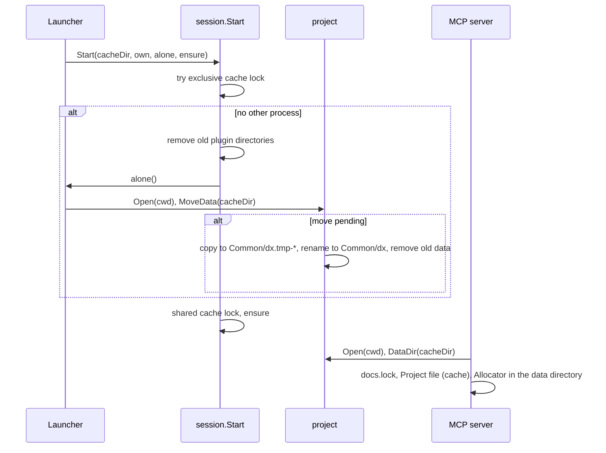

# TASK-068: Project data directory

## Document History
| Date | Author | Description / Change Notes |
| :--- | :--- | :--- |
| 2026-10-26 | Equal | Initial draft specification |

## 1. Summary

Add the project data directory of ADR-015 with `docs.lock` and the Project file (data) with the counters, and the Project file (cache) with the project path and last use date (ADR-018).

## 2. Problem and Motivation

- The docs lock and the counters are in `<cache>/projects/<key>/`. `cache clean` removes the counters, so two worktrees can then get the same ADR number.
- The cache folder of a project has a hash as its name, so `claude-dx clean` cannot show which project it is (ADR-018).

## 3. Goals

- G-1: The docs lock and the counters are in the project data directory: `<git-common-dir>/dx/` in git, else `<cache>/projects/<key>/`.
- G-2: For each project folder in the cache, a tool can read the project path and the last use date.
- G-3: After `git init`, all processes use one docs lock, before and after the move.

## 4. Out of Scope

- The clean command (TASK-069).

## 5. Context
### 5.1 Current State

- `project.Open` (`internal/project/project.go:22`) gives `Root` and `Key`. In git, `Key` is a hash of the git common directory; outside git, a hash of the start directory.
- The MCP server sets the counter folder and the docs lock to `<cache>/projects/<Key>/` (`internal/mcpserver/server.go:34`, `:35`).
- `numbering.Allocator` keeps the counters in `counters.json` (`internal/numbering/numbering.go:66`) and writes it with its own temporary file and rename (`:82`).
- `session.Start` holds the exclusive cache lock with no wait and removes old plugin directories (`internal/session/session.go:35`, `:40`). The launcher calls it (`internal/launcher/launcher.go:39`). The launcher does not know the project.
- `cache clean` keeps `cache.lock` and `projects/*/docs.lock` (`internal/session/session.go:73`).

### 5.2 Assumptions

- A-1: `git rev-parse --git-common-dir` gives the same directory in all worktrees of a repository. Verify: the R-1 test with two worktrees.
- A-2: A rename of a directory in the same parent directory is atomic on macOS, Linux and Windows when no file in it is open. Verify: the R-6 tests on the three platforms in CI.

### 5.3 Constraints

- ADR-015 (project data directory, docs lock, no process removes a lock file), ADR-016 (move after git init), ADR-017 (ADR-007 does not change), ADR-018 (two project files).
- Tests pass on macOS, Linux and Windows.

## 6. Requirements

### 6.1 Functional

- R-1: `project.Project` gets `Common`, the git common directory (empty outside git). The method `DataDir(cacheDir string) string` gives `<Common>/dx/` in git, else `<cache>/projects/<Key>/`. Exception: in git, if `<Common>/dx/` does not exist and `<cache>/projects/<key of Root>/` has data, it gives that cache folder until the move (R-6). Data is `project.json` or `tasks/`; `docs.lock` alone is not data.
- R-2: `docs.lock` is in the project data directory. The docs tools of the MCP server use it.
- R-3: Project file (data): `project.json` in the project data directory: `{"counters": {"adr": 18}}`. After TASK-064, `counters` has only `adr`. `numbering.Allocator` reads and writes it in place of `counters.json`.
- R-4: Project file (cache): `<cache>/projects/<Key>/project.json`: `{"path": "/abs/root", "last_used": "2026-10-26T12:00:00Z"}` (RFC 3339, UTC). The MCP server writes it at start, with the `Root` of its session, so in a repository with worktrees it has the root of the session that started last.
- R-5: All writes of the two files hold the docs lock of the project and use `docfile.Write`.
- R-6: `session.Start` gets the parameter `alone func()`, which it calls while it holds the exclusive cache lock. The launcher gives a function that runs `project.Open` on the current directory. In git, if R-1 gives the cache folder (the move is pending), it copies `project.json` and `tasks/` to a new folder `<Common>/dx.tmp-*`, renames it to `<Common>/dx/`, then removes `project.json` and `tasks/` from the old folder. The old `docs.lock` stays, because no process removes a lock file. It moves only the folder of the git top level. It also removes old `<Common>/dx.tmp-*` folders.
- R-7: If the move fails, the launcher writes "claude-dx: cannot move the project data from <old> to <new>: <error>. The data stays in <old>." to stderr, removes the temporary folder and starts the session. The old folder stays the project data directory (R-1), so no data is lost, and the next start with no other process tries again.
- R-8: Remove `counters.json` with no migration, because the allocation uses `max(counter, highest number in the checkout) + 1` (ADR-007), so a lost counter gives no duplicate number in the checkout.
- R-9: A new ADR supersedes ADR-007 with all number changes of v0.1.0: the docs lock protects the counter (TASK-059), only ADRs have numbers (ADR-016), and the counter is in the Project file (data). ADR-007 is pushed, so it does not change (ADR-017).

### 6.2 Non-Functional

- NFR-1: The launcher runs `project.Open` (two `git rev-parse`) only in the exclusive cache lock window.
- NFR-2: The MCP server writes the Project file (cache) one time at start.

## 7. Design

### 7.1 Architecture



- `project`: `Common`, `DataDir`, `MoveData`. The package has the R-1 rule and the move, so the launcher and the MCP server use one rule.
- `session.Start` does not know projects: it only calls `alone`.
- `numbering.Allocator.Dir` is the project data directory.

### 7.2 Public API

```go
// internal/project
type Project struct { Root, Key, Common string }
func (p Project) DataDir(cacheDir string) string
func (p Project) MoveData(cacheDir string) error // no-op when no move is pending

// internal/session
func Start(cacheDir, own string, alone func(), ensure func() (string, error)) (pluginDir string, end func(), err error)
```

No change of the commands and the MCP tools.

### 7.3 Data and File Formats

- New: `<Common>/dx/docs.lock`, `<Common>/dx/project.json` (`{"counters": {"adr": 18}}`), `<cache>/projects/<Key>/project.json` (`{"path": "/abs/root", "last_used": "2026-10-26T12:00:00Z"}`).
- Removed: `counters.json`. Old files stay until a clean.
- The copy takes regular files and directories, with their permission bits. Another file type stops the move (R-7).

### 7.4 User-facing Behavior

Only the warning of R-7 on stderr, when a move fails.

### 7.5 Alternatives

- Only a rename for the move: rejected, the cache and the repository can be on different file systems (Q-3).
- A move at the first tool call: rejected, two processes can then use two docs locks (ADR-016).
- Move all subdirectory folders: rejected, complex and the counters can conflict (Q-4).

## 8. Implementation Plan

| Work batch | Files | Steps | Check |
| :--- | :--- | :--- | :--- |
| 1 | `internal/project/project.go`, `internal/project/project_test.go` | R-1: `Common`, `DataDir`. R-6, R-7: `MoveData` (copy, rename, remove old data, remove `dx.tmp-*`). | `go test ./internal/project/` |
| 2 | `internal/numbering/numbering.go`, `internal/numbering/numbering_test.go` | R-3, R-5, R-8: `project.json` with `counters`, `docfile.Write`, no `counters.json`. | `go test ./internal/numbering/` |
| 3 | `internal/mcpserver/server.go`, `internal/mcpserver/server_test.go` | R-2, R-4: data directory for the lock and the Allocator, Project file (cache) at start. | `go test ./internal/mcpserver/` |
| 4 | `internal/session/session.go`, `internal/session/session_test.go`, `internal/launcher/launcher.go`, `cmd/claude-dx/main_test.go` | R-6, R-7: `alone` parameter, move and warning in the launcher. | `go test ./internal/session/ ./internal/launcher/ ./cmd/claude-dx/` |
| 5 | ADR (with `adr_create` and `adr_supersede`), `docs/GLOSSARY.md` (`Docs lock`, `Cache`) | R-9. | `adr_get`, `glossary_lookup Docs lock` |

## 9. Acceptance Criteria

- AC-1 (R-1, R-2): Given a git repository with two worktrees, then `DataDir` gives `<Common>/dx/` for both. Given no git, then it gives `<cache>/projects/<Key>/`.
- AC-2 (R-1): Given git, no `<Common>/dx/`, and a cache folder of the top level with `project.json`, then `DataDir` gives the cache folder. With only `docs.lock` there, it gives `<Common>/dx/`.
- AC-3 (R-3, R-5, R-8): Given a number allocation, then `project.json` in the data directory has the counter and no `counters.json` is made. Given an old `counters.json`, then the allocation ignores it.
- AC-4 (R-4): Given an MCP server start, then `<cache>/projects/<Key>/project.json` has the root and a `last_used` in RFC 3339 UTC.
- AC-5 (R-6): Given a project with data in the cache, then `git init`, when a start runs with no other process, then the data is in `<Common>/dx/`, the old folder has only `docs.lock`, and no `dx.tmp-*` stays.
- AC-6 (R-6): Given the same project while another process holds the shared cache lock, when a start runs, then no data moves and `DataDir` gives the cache folder.
- AC-7 (R-7): Given a move that fails (a file that is not a regular file or a directory in `tasks/`), then the launcher writes the warning, no `dx.tmp-*` stays, and `DataDir` gives the cache folder.
- AC-8 (R-9): Given the ADRs, then a new ADR supersedes ADR-007.

## 10. Validation and Metrics

| Metric | Baseline | Target | How to measure |
| :--- | :--- | :--- | :--- |
| Counters lost by `cache clean` in git projects | All | 0 | AC-3 |
| Docs locks for one project after `git init` | 2 possible | 1 | AC-5, AC-6 |

- Tests: unit tests for each AC, in temporary git repositories.
- Platforms not verified: none. CI runs on macOS, Linux and Windows.

## 11. Risks and Mitigations

| Risk | Impact | Mitigation |
| :--- | :--- | :--- |
| A dev build from before this task runs with a new binary in one git project, so the two use different docs locks | Low | Only dev builds: v0.1.0-rc.1 is deleted and no release has the old location (Q-5). |
| A crash after the rename and before the old data is removed | Low | `<Common>/dx/` exists, so R-1 gives it. The old data stays as garbage that `claude-dx clean` shows. |
| Until TASK-069, `cache clean` removes the data folders of projects outside git | Low | v0.1.0 is released only after TASK-069 (Q-6). |

## 12. Removal and Compatibility

Revert the change and the new ADR. Data in `<Common>/dx/` stays until a person removes it; the old binary does not read it, and its counter comes again from the files of the checkout (ADR-007).

## 13. Open Questions

| ID | Question | Owner | Answer |
| :--- | :--- | :--- | :--- |
| Q-1 | API: add `Common` (the git common directory, empty outside git) to `project.Project`, and a method `DataDir(cacheDir string) string` that applies R-1? Recommended: yes, because the MCP server and the launcher both need the same rule in one place. | Maintainer | Yes. project.Project gets Common and the method DataDir(cacheDir). |
| Q-2 | R-1 says "the cache folder has data". Is data = the folder has `project.json` or `tasks/`? Recommended: yes; `docs.lock` alone is not data. | Maintainer | Yes. Data is project.json or tasks/. docs.lock alone is not data. |
| Q-3 | Move after git init: the cache and the repository can be on different file systems, so a rename can fail. Copy the data to a temporary folder in the git common directory, rename it to `dx/` (the commit point), then remove the old data but `docs.lock`? Recommended: yes. | Maintainer | Yes. Copy to a temporary folder in the git common directory, rename it to dx/, then remove the old data but docs.lock. |
| Q-4 | Outside git the key is a hash of the start directory, so a start in a subdirectory gets another data folder. After git init, move only the folder of the git top level? Recommended: yes, and `claude-dx clean` shows the other folders. | Maintainer | Yes. Move only the folder of the git top level. claude-dx clean shows the other folders. |
| Q-5 | Git projects today have `counters.json` and `docs.lock` in `<cache>/projects/<key>/`. A new binary uses `.git/dx/docs.lock`, while a server of an old binary can still use the cache lock. Accept this risk only for v0.1.0-rc.1 and dev builds, with no migration? Recommended: yes. | Maintainer | Yes. Accept the risk for v0.1.0-rc.1 and dev builds, with no migration. Record it in Risks. |
| Q-6 | Until TASK-069, `cache clean` removes the data folders of projects outside git (counters, later tasks). Keep `cache clean` as it is, because v0.1.0 is released only after TASK-069? Recommended: yes. | Maintainer | Yes. Keep cache clean as it is. v0.1.0 is released only after TASK-069. |
| Q-7 | Worktrees of one repository share one key, so the Project file (cache) has one `path`. Write the root of the session that starts last? Recommended: yes, because it always exists when the server writes it. | Maintainer | Yes. Write the root of the session that starts last. |
| Q-8 | The move needs the exclusive cache lock window of `session.Start`. Add a parameter `alone func()` to `session.Start`, which it calls while it holds the exclusive lock, next to the plugin cleanup? Recommended: yes. | Maintainer | Yes. session.Start gets the parameter alone func(), called while it holds the exclusive cache lock. |
| Q-9 | Name the temporary folder `<git-common-dir>/dx.tmp-*`, and remove old `dx.tmp-*` folders in the same exclusive window, as the plugin cleanup does with `*.tmp-*`? Recommended: yes. | Maintainer | Yes. <git-common-dir>/dx.tmp-*, and old dx.tmp-* folders are removed in the same window. |
| Q-10 | If the move fails (example: a file that is not a regular file or a directory, or a full disk), the launcher writes a warning to stderr, removes the temporary folder and starts the session. The old folder stays the data directory, so no data is lost. Recommended: yes. | Maintainer | Yes. Warning on stderr, remove the temporary folder, start the session with the old folder as the data directory. |
| Q-11 | Warning text of a failed move (Q-10): "claude-dx: cannot move the project data from <old> to <new>: <error>. The data stays in <old>." Recommended: yes. | Maintainer | Yes. "claude-dx: cannot move the project data from <old> to <new>: <error>. The data stays in <old>." |
| Q-12 | The launcher runs `project.Open` (two `git rev-parse` processes, about 10 ms) only in the exclusive cache lock window, so only when no other claude-dx process runs. Accept this start cost? Recommended: yes. | Maintainer | Yes. Accept the cost of project.Open in the exclusive window. |
| Q-13 | JSON formats: Project file (cache) `{"path": "/abs/root", "last_used": "2026-10-26T12:00:00Z"}` (RFC 3339, UTC); Project file (data) `{"counters": {"adr": 18}}`. Recommended: yes. | Maintainer | Yes. Cache: {"path", "last_used" in RFC 3339 UTC}. Data: {"counters": {"adr": N}}. |

The status cannot be `Approved` while a question is `Open`.

## 14. Definition of Done
- [ ] All acceptance criteria pass, with evidence.
- [ ] Project checks (build, tests, lint) pass.
- [ ] Docs are updated (area docs, `CLAUDE.md`).
- [ ] The final Design diagrams that describe the code are in the docs of the area, with a link from this task.
- [ ] ADRs are recorded for architectural decisions.
